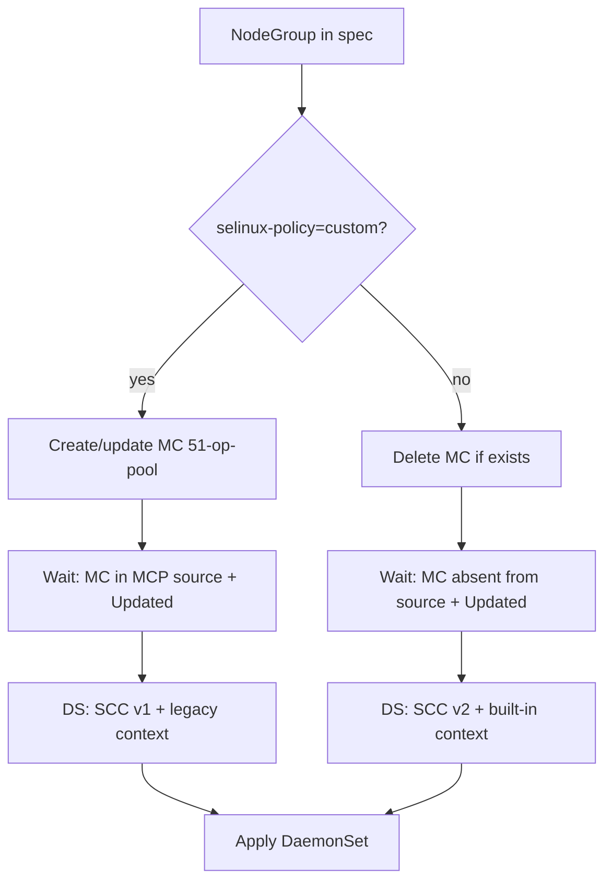
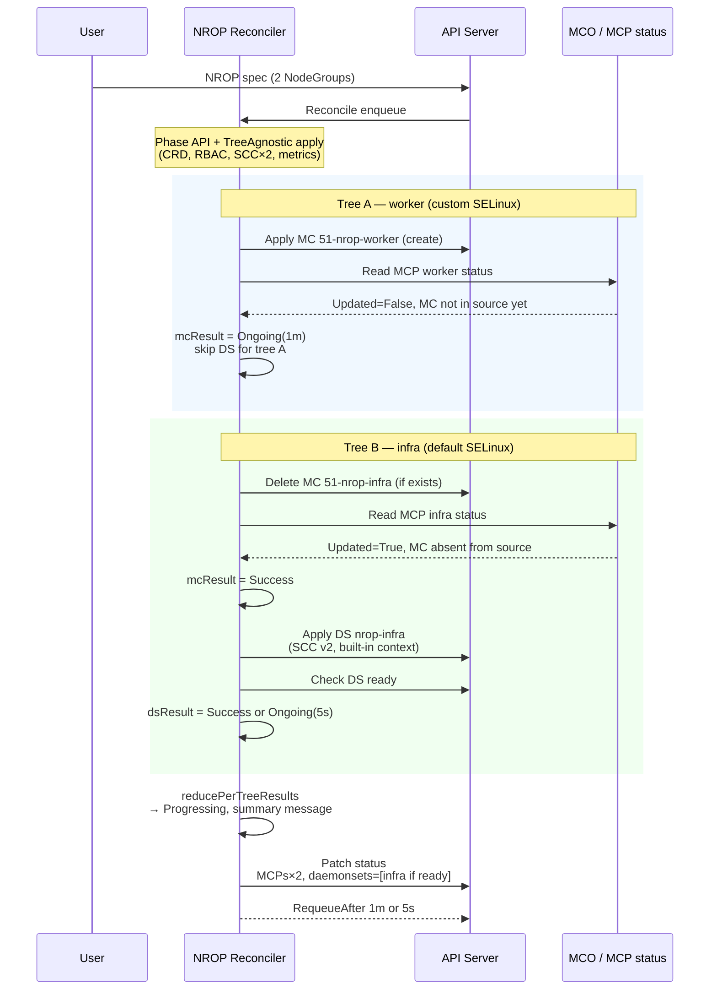
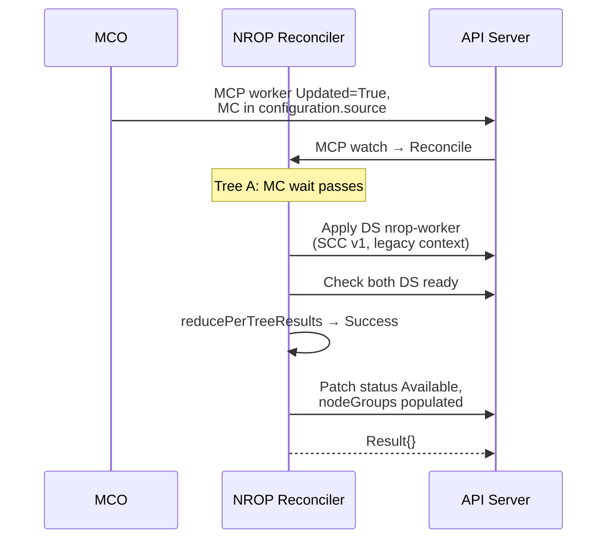
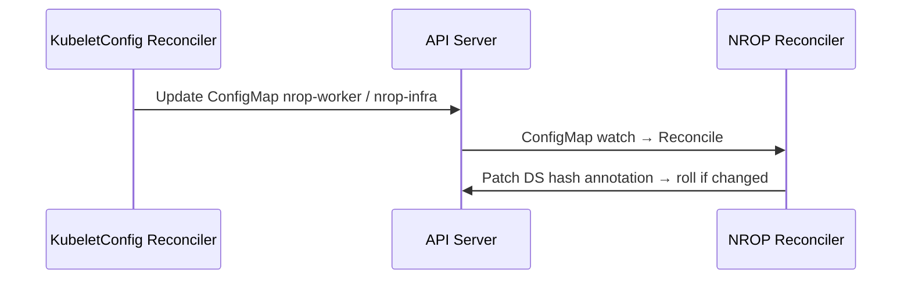
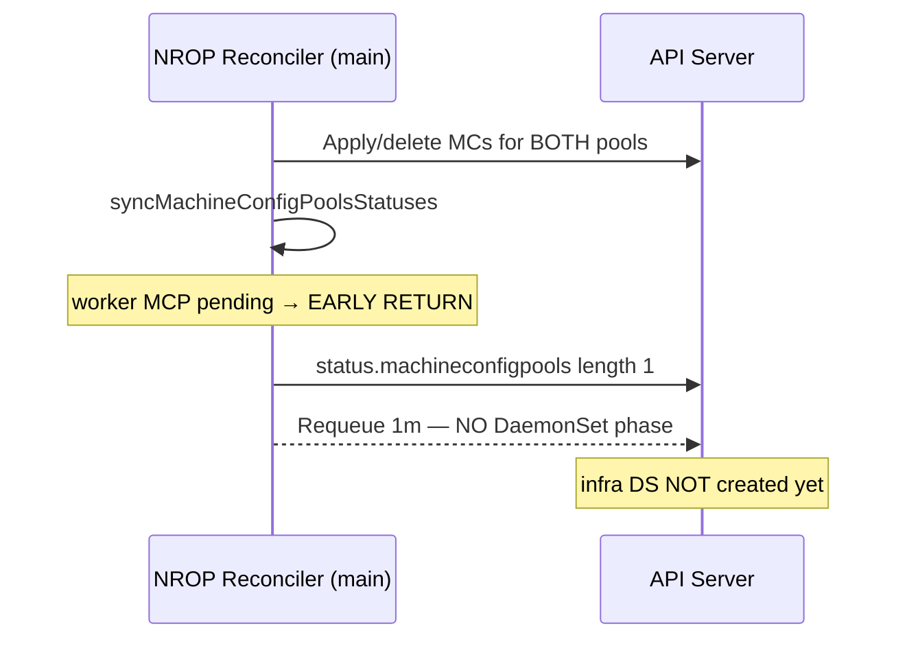

# NUMAResourcesOperator Reconciliation Architecture

This document describes how the **NUMAResourcesOperator (NROP)** controller reconciles cluster state today (on `main`), and how **[PR #3998](https://github.com/openshift-kni/numaresources-operator/pull/3998)** changes that behavior by moving from **horizontal** to **vertical** per-NodeGroup processing.

---

## Table of contents

1. [Overview](#overview)
2. [Core concepts](#core-concepts)
3. [Controller entry point and lifecycle](#controller-entry-point-and-lifecycle)
4. [Current architecture (horizontal split)](#current-architecture-horizontal-split)
5. [Object state layer](#object-state-layer)
6. [Status model](#status-model)
7. [Watch sources and requeue behavior](#watch-sources-and-requeue-behavior)
8. [PR #3998: vertical per-tree processing](#pr-3998-vertical-per-tree-processing)
9. [Before vs after comparison](#before-vs-after-comparison)
10. [Files changed by PR #3998](#files-changed-by-pr-3998)
11. [Operational implications](#operational-implications)
12. [Deep dive](#deep-dive)
13. [SELinux and SCC architecture](#selinux-and-scc-architecture)
14. [Step-by-step reconcile trace](#step-by-step-reconcile-trace)
15. [KubeletConfig controller](#kubeletconfig-controller)
16. [NUMAResourcesScheduler comparison](#numaresourcesscheduler-comparison)
17. [PR #3998 tests and guarantees](#pr-3998-tests-and-guarantees)
18. [Sequence diagram: mixed SELinux + vertical processing](#sequence-diagram-mixed-selinux--vertical-processing)
19. [PR #3998 reviewer checklist](#pr-3998-reviewer-checklist)
20. [References](#references)

---

## Overview

NROP is a Kubernetes operator (controller-runtime based) that deploys and manages **Resource Topology Exporter (RTE)** DaemonSets across one or more **NodeGroups**. On OpenShift, each NodeGroup is tied to a **MachineConfigPool (MCP)** and may require MachineConfig objects before RTE can run safely on those nodes.

The operator's job in each reconcile loop is to:

1. Validate the `NUMAResourcesOperator` CR and resolve NodeGroups into internal **Tree** objects.
2. Ensure shared infrastructure exists (CRD, RBAC, SCC, network policies, metrics).
3. On OpenShift, sync MachineConfigs and wait for MCP rollout.
4. Create/update per-pool RTE DaemonSets and wait until they are ready.
5. Publish aggregated status back to the CR.

The central design tension addressed by PR #3998 is **multi-NodeGroup progress**: when several pools exist, should one slow pool block all others?

---

## Core concepts

### NUMAResourcesOperator CR

- **Singleton cluster-scoped CR** named `numaresourcesoperator`.
- **Spec** contains a list of `NodeGroups`, each describing which nodes should run RTE and how (config, image overrides via annotations, pool selection).
- **Status** reports operator conditions, MCP states, DaemonSet references, and per-NodeGroup observed state.

Relevant API types live in `api/v1/numaresourcesoperator_types.go`.

### NodeGroup

A `NodeGroup` selects nodes either by:

- `poolName` — direct MCP name, or
- `machineConfigPoolSelector` — label selector matching MCP(s)

Each NodeGroup carries optional `config` (RTE behavior: info mode, tolerations, kubelet settings, etc.) and optional annotations.

### Tree (internal abstraction)

A **Tree** binds one NodeGroup to its resolved MachineConfigPool(s):

```go
type Tree struct {
    NodeGroup          *nropv1.NodeGroup
    MachineConfigPools []*mcov1.MachineConfigPool
}
```

Defined in `api/v1/helper/nodegroup/nodegroup.go`. Trees are built at reconcile time via `getTreesByNodeGroup()`:

- **OpenShift**: lists MCPs cluster-wide, matches each NodeGroup (`FindTreesOpenshift`).
- **HyperShift**: synthetic trees without MCP objects (`FindTreesHypershift`).

Design intent is **1:1 NodeGroup ↔ MCP**, though the code historically allows 1:N in the Tree type.

### Step (reconcile outcome)

Internal package `internal/reconcile` wraps controller-runtime results:

| Step | Meaning | Typical requeue |
|------|---------|-----------------|
| `StepSuccess()` | Sub-step complete | None |
| `StepOngoing(d)` | Waiting on external progress | After `d` |
| `StepFailed(err)` | Hard failure → Degraded | None |

`EarlyStop()` is true whenever the condition is not `Available`, causing parent orchestration to return immediately.

### ExistingManifests / object state

Package `pkg/objectstate/rte` compares **desired** manifests (from embedded operator assets) with **existing** cluster objects. It produces `ObjectState` slices consumed by `pkg/apply` to create/patch/delete resources.

`FromClient()` loads RBAC, SCC, metrics, MachineConfigs, and per-tree DaemonSets for all trees in one structure.

---

## Controller entry point and lifecycle

Implementation: `internal/controller/numaresourcesoperator_controller.go`

### High-level flow

```
Reconcile(request)
  ├─ Load NUMAResourcesOperator CR
  ├─ Initialize / backfill status conditions
  ├─ Guard rails (name, pause annotation, validation)
  ├─ Build []Tree from spec NodeGroups
  ├─ reconcileResource(instance, trees)  ← core work
  ├─ Compute top-level conditions from Step
  ├─ Optional degrade if tolerable validation warning
  └─ Patch status + return Result/RequeueAfter
```

### Guard rails before resource sync

1. **Resource name** must be `numaresourcesoperator`.
2. **Pause annotation** skips reconciliation entirely.
3. **`validation.NodeGroups`** checks spec shape for the platform.
4. **`getTreesByNodeGroup`** resolves MCP bindings.
5. **`validation.NodeGroupsTree`** checks tree consistency (e.g. MCP found, paused handling).

Each NodeGroup config is normalized in-place before reconciliation proceeds.

### Reconciler dependencies

`NUMAResourcesOperatorReconciler` holds platform info, embedded manifests (`APIManifests`, `RTEManifests`), namespace, images, TLS settings for RTE metrics, and feature flags like `ForwardMCPConds`.

---

## Current architecture (horizontal split)

Today, `reconcileResource()` orchestrates **three global phases**. Every NodeGroup must complete phase N before **any** NodeGroup enters phase N+1.

```
┌─────────────────────────────────────────────────────────────┐
│ Phase 1: API (global)                                       │
│   reconcileResourceAPI() → install NodeResourceTopology CRD │
└──────────────────────────────┬──────────────────────────────┘
                               ▼
┌─────────────────────────────────────────────────────────────┐
│ Load state: rtestate.FromClient(..., all trees)             │
└──────────────────────────────┬──────────────────────────────┘
                               ▼
┌─────────────────────────────────────────────────────────────┐
│ Phase 2: MachineConfig (OpenShift only, ALL trees)          │
│   syncMachineConfigs(trees)                                 │
│   syncMachineConfigPoolsStatuses(trees)                     │
│   → EarlyStop if ANY MCP still updating                     │
└──────────────────────────────┬──────────────────────────────┘
                               ▼
┌─────────────────────────────────────────────────────────────┐
│ Phase 3: DaemonSet (ALL trees)                              │
│   syncNUMAResourcesOperatorResources(trees)                 │
│   syncDaemonSetsStatuses(all daemonsets)                    │
│   → EarlyStop if ANY DaemonSet not ready                    │
└──────────────────────────────┬──────────────────────────────┘
                               ▼
┌─────────────────────────────────────────────────────────────┐
│ Publish NodeGroups status (only if all phases succeeded)    │
└─────────────────────────────────────────────────────────────┘
```

### Phase 1: API reconciliation

`reconcileResourceAPI()` installs the Node Resource Topology CRD unless an annotation opts out. Failure → `StepFailed`; success → continue.

### Phase 2: MachineConfig (OpenShift)

`reconcileResourceMachineConfig()`:

1. **`syncMachineConfigs`** iterates **all** trees via `existing.MachineConfigsState()`, which internally loops `em.trees`. For each pool it applies or removes MachineConfig objects and records wait functions for MCP updates.

2. **`syncMachineConfigPoolsStatuses`** walks every MCP in every tree. On the **first** pool that is not yet updated, it returns immediately with that pool name:

   ```go
   if !isUpdated {
       return mcpStatuses, mcp.Name  // blocks entire phase
   }
   ```

3. If any MCP is pending → `StepOngoing(1 minute)` with reason `MachineConfigPoolIsUpdating`. **DaemonSet phase never runs.**

4. Paused MCPs are tracked in a dedicated condition (`MachineConfigPoolPaused`).

### Phase 3: DaemonSet reconciliation

`reconcileResourceDaemonSet()` → `syncNUMAResourcesOperatorResources()`:

1. Deletes dangling DaemonSets / MachineConfigs no longer referenced.
2. Applies global DaemonSet template settings (image, log level, affinity, SCC).
3. Registers a manifest updater that customizes each pool's DaemonSet (TLS flags, tolerations, etc.).
4. Calls `existing.State(mf)` which emits object states for:
   - Shared resources (ServiceAccount, Roles, SCC, NetworkPolicies, …)
   - **Per-tree** resources from `helper.FindState()` (DaemonSet per pool)
   - Metrics Service
5. Applies all objects via `apply.ApplyObject`.

Then **`syncDaemonSetsStatuses`** checks readiness **sequentially**; the first not-ready DaemonSet stops the loop and triggers `StepOngoing(5s)`.

Finally, **`syncNodeGroupsStatus`** builds per-NodeGroup status entries from MCP + DaemonSet info.

### Why this is "horizontal"

Think of reconciliation stages as **rows** and NodeGroups as **columns**:

| Stage | Pool A | Pool B | Pool C |
|-------|--------|--------|--------|
| MachineConfig | must complete | must complete | must complete |
| MCP wait | must complete | must complete | must complete |
| DaemonSet | blocked until row above done for **all** | blocked | blocked |
| DS ready | blocked | blocked | blocked |

The **slowest NodeGroup at the current stage blocks every other NodeGroup** from advancing to the next stage.

### Example failure scenario

Cluster with pools `worker` (rebooting after MC change) and `infra` (idle, MCP already updated):

| Pass | worker MCP | infra MCP | Controller behavior |
|------|------------|-----------|---------------------|
| 1 | Updating | Ready | Returns ongoing — **no RTE work for infra** |
| 2 | Updating | Ready | Still blocked at MC phase |
| N | Ready | Ready | Finally creates/updates both DaemonSets |

Infra nodes could have received RTE updates much earlier but did not.

---

## Object state layer

### FromClient (current)

`rtestate.FromClient(ctx, cli, plat, mf, instance, trees, namespace)`:

1. Loads cluster-scoped and namespace-scoped shared objects.
2. For **each tree**, calls `helper.UpdateFromClient()` to load MCP-specific MachineConfigs and DaemonSets into maps on `ExistingManifests`.
3. Loads metrics Service and NetworkPolicies.

### State()

`ExistingManifests.State(mf)` returns a flat slice:

- Fixed shared objects (RBAC, SCC, policies)
- **`for _, tree := range em.trees`** → append per-tree states (DaemonSet, and on OpenShift MC-related state via helper)
- Metrics Service

The controller applies this entire list in one pass during `syncNUMAResourcesOperatorResources`.

### MachineConfigsState (current)

`MachineConfigsState(mf)` loops **all trees internally**:

```go
for _, tree := range em.trees {
    for _, mcp := range tree.MachineConfigPools {
        // build MachineConfigObjectState per pool
    }
}
```

Returns aggregated MC states and paused MCP name set. There is no way to sync MC for one pool without involving the full multi-tree function.

---

## Status model

### Top-level conditions

Managed via `pkg/status` and updated each reconcile from the final `Step`:

| Condition | Meaning |
|-----------|---------|
| `Available` | Reconciliation complete |
| `Progressing` | Waiting on external action (MCP, DaemonSet) |
| `Degraded` | Validation or apply error |
| `Upgradeable` | Backfilled on upgrade |
| `MachineConfigPoolPaused` | One or more MCPs paused |

### Status fields

| Field | Content |
|-------|---------|
| `status.conditions` | Operator health |
| `status.machineconfigpools` | Per-MCP conditions + config snapshot |
| `status.daemonsets` | Names of **ready** RTE DaemonSets |
| `status.nodeGroups` | Per-NodeGroup `{poolName, config, daemonSet}` — published only when full reconcile succeeds |
| `status.relatedObjects` | References for UI / OCP console |

### Status update timing (current)

During MC and DS phases, partial status is written (MCP list, ready DaemonSets so far). **`NodeGroups` is only populated when the entire `reconcileResource` returns success**, because all fields are required to form a valid `NodeGroupStatus`.

---

## Watch sources and requeue behavior

`SetupWithManager()` registers:

| Watch | Purpose |
|-------|---------|
| `NUMAResourcesOperator` | Spec/generation/label changes |
| `MachineConfigPool` (OpenShift) | MCP status/selector/paused changes → enqueue NROP |
| `ConfigMap` (RTE-labeled) | Config changes |
| Owned: CRD, SA, Roles, DaemonSet, SCC, MachineConfig | Owned object updates |

Requeue intervals:

- MCP not updated: **1 minute** (`numaResourcesRetryPeriod`)
- DaemonSet not ready: **5 seconds**

MCP watches map back to NROP via `mcpToNUMAResourceOperator`, matching pool names/labels against configured NodeGroups.

---

## PR #3998: vertical per-tree processing

**PR:** [openshift-kni/numaresources-operator#3998](https://github.com/openshift-kni/numaresources-operator/pull/3998)  
**JIRA:** CNF-23239  
**Branch:** `per-tree-processing` → `main`  
**State:** Open (as of document date)

### Problem statement

Horizontal orchestration creates unnecessary coupling: a single slow or rebooting MCP prevents RTE rollout, updates, and status convergence on unrelated pools.

### Solution: vertical split

Each **Tree** (NodeGroup/MCP) runs its own MC → DaemonSet pipeline. Results are **aggregated** into global status. Global condition remains `Progressing` until all trees complete, but fast trees are no longer held at earlier stages.

```
┌─────────────────────────────────────────────────────────────┐
│ Phase 1: API (global) — unchanged                           │
└──────────────────────────────┬──────────────────────────────┘
                               ▼
┌─────────────────────────────────────────────────────────────┐
│ Tree-agnostic setup (once)                                  │
│   FromClientTreeAgnostic()                                  │
│   setupTreeAgnosticManifests()                              │
│   apply TreeAgnostic() objects                              │
│   delete dangling DS/MC                                     │
└──────────────────────────────┬──────────────────────────────┘
                               ▼
        ┌──────────────────────┴──────────────────────┐
        ▼                      ▼                      ▼
   ┌─────────┐           ┌─────────┐           ┌─────────┐
   │ Tree A  │           │ Tree B  │           │ Tree C  │
   │ MC sync │           │ MC sync │           │ MC sync │
   │ MCP wait│           │ MCP wait│           │ MCP wait│
   │ DS sync │           │ DS sync │           │ DS sync │
   │ DS ready│           │ DS ready│           │ DS ready│
   └────┬────┘           └────┬────┘           └────┬────┘
        └──────────────────────┼──────────────────────┘
                               ▼
┌─────────────────────────────────────────────────────────────┐
│ reducePerTreeResults() → aggregate status + overall Step    │
└─────────────────────────────────────────────────────────────┘
```

### New reconcileResource flow (PR)

Pseudocode reflecting the PR's final controller structure:

```go
func reconcileResource(ctx, instance, trees) Step {
    if step := reconcileResourceAPI(...); step.EarlyStop() { return step }

    existing := FromClientTreeAgnostic(...)
    setupTreeAgnosticManifests(...)
    applyObjects(existing.TreeAgnostic(...))
    deleteUnusedDaemonSets/MachineConfigs(...)

    var results []perTreeResult
    for _, tree := range trees {
        treeExisting := existing.PerTree(ctx, cli, tree)

        mcResult := reconcilePerTreeMachineConfig(..., treeExisting, tree)
        if mcResult.step.EarlyStop() {
            results = append(results, mcResult)
            continue  // skip DS for THIS tree only
        }

        dsResult := reconcilePerTreeDaemonSet(..., treeExisting, tree)
        dsResult.mcpStatuses = mcResult.mcpStatuses
        dsResult.pausedMCPNames = mcResult.pausedMCPNames
        results = append(results, dsResult)
    }

    overall := reducePerTreeResults(results)
    // patch status.machineconfigpools, daemonsets, conditions, relatedObjects
    if overall.step.Done() {
        instance.Status.NodeGroups = syncNodeGroupsStatus(instance, overall.dsInfo)
    }
    return overall.step
}
```

Key behavioral difference: **`continue` on MC EarlyStop** — that tree skips DaemonSet work for this pass, other trees proceed.

### perTreeResult aggregation

New struct:

```go
type perTreeResult struct {
    dsInfo         []poolDaemonSet
    mcpStatuses    []nropv1.MachineConfigPool
    pausedMCPNames sets.Set[string]
    step           intreconcile.Step
}
```

`reducePerTreeResults()`:

- Unions all MCP statuses and paused MCP names.
- Appends DaemonSet info only from trees whose step `Done()`.
- Selects overall step with priority: failures > ongoing (shorter requeue wins) > success.
- Adds summary message, e.g. `"2/3 completed, 1/3 updating"`.

New `Step` helpers in PR: `Ongoing()`, `Failed()`, `UpdateMessage()`.

### Object state refactor (PR)

| Current | PR |
|---------|-----|
| `FromClient(..., trees)` | `FromClientTreeAgnostic(...)` — no tree iteration at load |
| `State(mf)` — shared + all trees | `TreeAgnostic(mf)` — RBAC, SCC, policies, metrics only |
| (n/a) | `PerTree(ctx, cli, tree)` — load one tree's DS/MC state |
| (n/a) | `PerTreeState(mf, tree)` — desired states for one tree |
| `MachineConfigsState(mf)` loops all trees | `MachineConfigsState(mf, tree)` — single tree |

Tree-specific loading moves from bulk upfront fetch to **on-demand per iteration**.

### Helper signature narrowing (PR)

Functions that previously accepted `[]Tree` now accept a single `nodegroupv1.Tree`:

- `syncMachineConfigs` → `syncMachineConfig`
- `syncMachineConfigPoolsStatuses(..., trees, ...)` → `(..., tree)`
- `validateMachineConfigLabels(mc, trees)` → `(mc, tree)`

New helper: `Tree.Name()` for consistent pool naming in logs and messages.

### Condition messaging (PR)

`conditioninfo.UpdateMessage()` and `Step.UpdateMessage()` allow enriching status text (e.g. per-tree progress summary) without resetting error/requeue state.

### Commit strategy (PR)

12 commits designed for backport safety:

1. Utilities (Name helper, UpdateMessage, step helpers)
2. Move controller helpers
3. RTE refactor + temporary compat wrappers (controller unchanged)
4. Add per-tree functions (dead code initially)
5. Wire per-tree functions into controller
6. Narrow signatures, remove compat wrappers
7. Final switch to vertical orchestration

Reviewers are advised to read the **final diff** (`git diff main..HEAD`) rather than each commit in isolation.

---

## Before vs after comparison

### Orchestration model

| Aspect | Horizontal (main) | Vertical (PR #3998) |
|--------|-------------------|---------------------|
| MC sync scope | All trees in one call | One tree per call |
| MCP wait | First pending blocks all | Pending blocks only that tree |
| DS creation | All trees after all MCPs ready | Per tree when its MCP ready |
| DS readiness check | First not-ready blocks reporting | Aggregated per tree |
| Shared resources | Applied inside DS sync with all trees | Applied once before tree loop |
| NodeGroups status | All-or-nothing at end | Still all-or-nothing for full Available, but DS/MCP status reflects partial progress |

### Example timeline (worker slow, infra fast)

| Time | Horizontal | Vertical |
|------|------------|----------|
| T0 | Both at MC phase | Both start MC phase |
| T1 | worker MCP updating; infra blocked | worker waiting; **infra DS created** |
| T2 | Still blocked | infra DS ready; worker still on MC |
| T3 | worker done; both DS updated | worker DS created |
| T4 | Both ready | worker ready; operator Available |

Global `Progressing` persists until T4 in both models; vertical model delivers infra RTE at T1–T2 instead of T3.

### Concurrency model

Both models use a **single reconcile goroutine** processing trees sequentially. PR #3998 does not introduce parallel reconciliation. A slow `apply` on one tree still delays the start of the next tree's work in the same pass, but it no longer prevents that tree from having advanced through earlier **global** gates in a previous pass.

---

## Files changed by PR #3998

| File | Role |
|------|------|
| `internal/controller/numaresourcesoperator_controller.go` | Core orchestration rewrite |
| `internal/controller/numaresourcesoperator_controller_test.go` | Async convergence tests |
| `pkg/objectstate/rte/rte.go` | Tree-agnostic vs per-tree state API |
| `pkg/objectstate/rte/machineconfigpool.go` | Single-tree MC state |
| `pkg/objectstate/rte/machineconfigpool_test.go` | Per-tree test updates |
| `internal/reconcile/step.go` | Ongoing/Failed/UpdateMessage |
| `internal/reconcile/step_test.go` | Step helper tests |
| `pkg/status/conditioninfo/conditioninfo.go` | UpdateMessage |
| `pkg/status/conditioninfo/conditioninfo_test.go` | Tests |
| `api/v1/helper/nodegroup/nodegroup.go` | Tree.Name() |
| `api/v1/helper/nodegroup/nodegroup_test.go` | Tests |

**Stats:** +598 / −368 lines, 12 commits, 11 files.

---

## Operational implications

### For cluster admins

- **Faster partial rollout** when one MCP is rebooting or paused and others are healthy.
- **Status messages** may show progress fractions (`2/3 updating`) under vertical processing.
- **Global Available** still requires all NodeGroups complete — no change to "operator is fully ready" semantics.
- **Paused MCPs** still surface via `MachineConfigPoolPaused`; affected trees wait, others continue.

### For developers / reviewers

- When reviewing PR #3998, compare final tree state against `main`, not intermediate compat-layer commits.
- Backport to 4.18 is high effort due to diverged `machineconfigpool.go`; 4.19+ needs PR #3801 backport first.
- Controller tests now verify staged DaemonSet creation while one MCP is still updating.

### Unchanged behavior

- CRD/API validation and degrade paths
- Pause reconciliation annotation
- MCP / DaemonSet watch-driven requeues
- HyperShift path (no MachineConfig phase)
- Singleton CR name enforcement

---

## Deep dive

This section goes into implementation-level detail: cross-controller dependencies, MachineConfig semantics, status update timing, and the exact aggregation logic introduced by PR #3998.

### Operator binary: what runs besides NROP

`cmd/main.go` constructs one controller-runtime **Manager** and registers:

```
Manager
├── NUMAResourcesOperatorReconciler   ← RTE deployment (this document's focus)
├── KubeletConfigReconciler           ← per-pool RTE kubelet ConfigMaps
├── NUMAResourcesSchedulerReconciler  ← optional (--enable-scheduler)
├── SecurityProfileWatcher            ← restarts operator on APIServer TLS profile change
└── Webhooks (optional)               ← CR conversion
```

Cache scope is limited to the operator namespace plus cluster-scoped objects (`DefaultNamespaces`).

### Cross-controller: KubeletConfig → RTE DaemonSet

RTE needs kubelet configuration (CPU manager policy, topology manager, reserved resources, etc.) rendered into a volume mounted in each pool's DaemonSet. That path is **not** handled inside `reconcileResource` directly.

```
MCO KubeletConfig (OpenShift)
        │
        ▼
KubeletConfigReconciler.Reconcile
        │  match KubeletConfig → MCP via MachineConfigPoolSelector
        ▼
syncConfigMap → ConfigMap `{operator}-{pool}` in operator namespace
        │  ownerRef → KubeletConfig (not NROP CR)
        ▼
NROP reconcile (later pass)
        │  getDaemonSetManifest reads same ConfigMap key as DS name
        ▼
hash.ConfigMapData → RTEConfigHash
        │
        ▼
daemonsetUpdater → rteupdate.DaemonSetHashAnnotation on DS
```

Important consequences:

- If kubelet config changes, ConfigMap updates; NROP must reconcile to roll DS. NROP watches ConfigMaps labeled with the operator name (`configMapToNUMAResourceOperator`).
- If KubeletConfig controller has not yet created the ConfigMap, hash may be empty; DS still deploys but may roll again once hash appears.
- HyperShift uses a labeled ConfigMap in `openshift-config-managed` instead of MCO `KubeletConfig`.

This is a **second axis of per-pool async work** independent of MCP rollout, but it does not gate the MachineConfig phase — it affects DS spec on each apply.

### Tree resolution in detail

`getTreesByNodeGroup` is the bridge from user-facing spec to internal reconciliation units.

**OpenShift (`FindTreesOpenshift`):**

For each `NodeGroup` in spec order:

1. If `poolName` set → scan MCP list for exact name match (at most one MCP).
2. If `machineConfigPoolSelector` set → append **all** MCPs whose labels match (historically 1:N; discouraged since 4.18 unless annotation `config.node.openshift-kni.io/multiple-pools-per-tree=enabled`).
3. If zero MCPs matched → hard error from tree building (`failed to find MachineConfigPool`).

**HyperShift (`FindTreesHypershift`):**

Each NodeGroup becomes a Tree with only `NodeGroup` populated — no MCP objects. DaemonSet nodeSelector uses `hypershift.openshift.io/nodePool: {poolName}`.

Validation runs **before** and **after** tree build:

| Check | When | Severity |
|-------|------|----------|
| `NodeGroups()` — spec shape, duplicates, selectors | Before trees | Hard fail → Degraded |
| `MCPsDuplicates()` — same MCP in two NodeGroups | After trees | Hard fail |
| `MultipleMCPsPerTree()` — >1 MCP in one tree | After trees | Tolerable → Degraded **after** successful reconcile step |

The tolerable error pattern (`Reconcile` lines 189–191) means: work can complete (e.g. MCP wait) but operator still degrades if multi-pool-per-tree is disallowed.

### MachineConfig phase: two radically different paths

On OpenShift, `MachineConfigsState` decides per MCP whether to **create**, **delete**, or **skip** the operator-owned MachineConfig.

#### Path A — default (built-in SELinux since 4.18)

When `config.node.openshift-kni.io/selinux-policy` is **not** `custom`:

- **Desired MC = nil** → `ApplyState` **deletes** the legacy MC if it exists.
- **Wait function** = `IsMachineConfigPoolUpdatedAfterDeletion`:
  - Returns false while MC name still appears in `mcp.Status.Configuration.Source`.
  - Returns false while MCP condition `Updated=False`.
  - Returns true only when MC is gone from pool config **and** pool reports updated.

This supports upgrade from releases that deployed custom SELinux MachineConfigs.

#### Path B — custom SELinux policy annotation

When custom policy enabled on the NodeGroup:

- **Desired MC** is created with name `51-{operator}-{pool}` and labels from `GetMachineConfigLabel(mcp)`.
- **Wait function** = `IsMachineConfigPoolUpdated`:
  - Returns false until MC appears in MCP configuration source.
  - Returns false while `Updated=False`.

#### Paused MCPs

If `mcp.Spec.Paused`:

- No MC state emitted for that pool.
- Pool name added to `pausedMCPNames` set.
- Controller sets `MachineConfigPoolPaused=True` with list of paused pools.
- MCP is **not** waited on for `Updated` — reconciliation intentionally stalls for that tree until unpaused.

### The horizontal gate: code + test evidence

Two functions implement the "slowest pool blocks everyone" behavior on `main`:

**1. Early return in MCP status scan**

```go
// syncMachineConfigPoolsStatuses — returns on FIRST not-updated pool
if !isUpdated {
    return mcpStatuses, mcp.Name
}
```

Pools after the first pending one are never evaluated in that pass. Status may list MCPs only up to the blocking pool.

**2. Phase gate in reconcileResource**

```go
if step := r.reconcileResourceMachineConfig(...); step.EarlyStop() {
    return step  // DaemonSet phase never runs
}
```

**Controller test proof** (`numaresourcesoperator_controller_test.go`, two MCPs not ready):

- After second reconcile while MCPs still updating: `status.machineconfigpools` has **length 1** (only `test1`), not 2.
- Requeue is `1 minute` (`numaResourcesRetryPeriod`).
- DaemonSets for **neither** pool exist until **both** MCPs are marked ready, then next reconcile creates RBAC, SCC, both DS, metrics Service in one pass.

That test encodes the current contract PR #3998 intentionally breaks for faster pools.

### DaemonSet generation pipeline (single tree)

For each tree, `machineConfigPoolFinder.FindState` (OpenShift) or `nodeGroupFinder.FindState` (HyperShift):

1. **Load existing DS** from `daemonSets[generatedName]` (includes optional ConfigMap hash lookup).
2. **Clone template** `mf.Core.DaemonSet`, rename to `{operator}-{pool}`.
3. **Node selector** — from MCP `nodeSelector.matchLabels` (OpenShift) or HyperShift nodePool label.
4. **Build `GeneratedDesiredManifest`** — platform, MCP pointer, NodeGroup copy, SCC options, hash.
5. **Run `updater` callback** (`daemonsetUpdater`):
   - Termination message policy, tolerations from NodeGroup config
   - RTE container args (info mode, TLS min version/ciphers from cluster profile)
   - OpenShift/HyperShift: mount kubelet config volume, SELinux context via SCC
   - Hash annotation linking to kubelet ConfigMap
6. Emit one `ObjectState` for the DaemonSet → `apply.ApplyObject` in sync loop.

Global template mutations (image, log level, affinity, pause container) happen once in `syncNUMAResourcesOperatorResources` **before** `State()` iterates all trees — mutating the shared embedded manifest in memory.

### Apply semantics (create / update / delete)

`pkg/apply` centralizes cluster writes:

| `Desired` | `Existing` load error | Action |
|-----------|----------------------|--------|
| non-nil | NotFound | Create |
| non-nil | Found | Merge + compare → Update if different |
| nil | Found | Delete |
| nil | NotFound | No-op |

MachineConfig deletion (Path A) relies on `Desired=nil` with careful nil-interface handling (see comment in `machineconfigpool.go` about Go nil interface pitfalls).

### Status field update matrix (current / main)

What gets written to `NUMAResourcesOperator.status` during a reconcile pass:

| Field | When updated | Notes |
|-------|--------------|-------|
| `conditions` (base) | End of `Reconcile` from final `Step` | Available/Progressing/Degraded/Upgradeable flip together via `NewBaseConditions` |
| `conditions` (MCPPaused) | During MC phase | Independent of base conditions |
| `machineconfigpools` | During MC phase | May be partial list if horizontal early-return |
| `daemonsets` | During DS phase | Only **ready** DS names (not merely created) |
| `relatedObjects` | During DS phase | RTE references for console |
| `nodeGroups` | Only if entire `reconcileResource` succeeds | All-or-nothing; API comments require complete entries |

So during a long MCP wait you can see `Progressing` + partial MCP status + **empty** `nodeGroups` + **no** DaemonSets in status even if DS objects might exist from a previous spec (unlikely on fresh install).

### Condition algebra

`Step` carries `ConditionInfo` which maps to a single metav1 condition type, but `ComputeConditions` for base types replaces **all four** base conditions atomically:

- `Available` step → Available=True, Upgradeable=True, Progressing=False, Degraded=False
- `Progressing` step → Progressing=True, others false (except Upgradeable follows Available rules)
- `Failed` step → Degraded=True

`WithReason` / `WithMessage` on Step only fill empty fields — they do not overwrite (until PR #3998 adds `UpdateMessage` for aggregation summaries).

### Requeue timing strategy

| Wait reason | RequeueAfter | Rationale |
|-------------|--------------|-----------|
| MCP updating | 1 minute | MCO rollout + node reboots are slow |
| DaemonSet not ready | 5 seconds | Pod scheduling/convergence is faster |
| KubeletConfig (no NROP yet) | 30 seconds | Separate controller |

MCP changes also trigger immediate requeue via watch → `mcpToNUMAResourceOperator`.

### Garbage collection of removed pools

When NodeGroups are removed from spec, `dangling.DeleteUnusedDaemonSets` / `DeleteUnusedMachineConfigs` delete owned objects whose names are not in the expected set derived from current trees. Runs at start of DS sync — so on `main`, **only when MC phase already passed**, removed pools' DS might linger until MCP gate clears.

PR #3998 moves dangling delete to **before** the per-tree loop (after tree-agnostic apply), so cleanup happens earlier in the pass.

### ForwardMCPConds flag

When `--enable-mcp-conds-fwd` is set, `extractMCPStatus` copies MCP `.status.conditions` into `NUMAResourcesOperator.status.machineconfigpools[].conditions`. Default off — status shows pool name (+ config after sync) only.

### PR #3998: per-tree loop semantics

After shared setup, for each tree in spec order:

```
mcResult = reconcilePerTreeMachineConfig(tree)
if mcResult.step.EarlyStop():
    append mcResult; continue   // no DS work this tree this pass

dsResult = reconcilePerTreeDaemonSet(tree)
merge mcResult MCP data into dsResult
append dsResult
```

So tree B's DaemonSet reconciliation runs even when tree A is stuck in `MachineConfigPoolIsUpdating`.

#### Paused MCP handling in PR

In `reconcilePerTreeMachineConfig`, after successful MCP wait:

```go
if result.pausedMCPNames.Len() > 0 {
    result.step = intreconcile.StepOngoing(0)
} else {
    result.step = intreconcile.StepSuccess()
}
```

A tree with only paused MCP(s) never reaches DS phase (`EarlyStop`), but other trees proceed.

#### reducePerTreeResults algorithm

Pseudocode:

```
acc.step = Success
for each per-tree result R:
    acc.mcpStatuses += R.mcpStatuses
    acc.pausedMCPs |= R.pausedMCPs

    if R.step is Success:
        acc.dsInfo += R.dsInfo
        continue

    count R as error or ongoing
    acc.step = pickMoreSevere(acc.step, R.step)

if acc.step is not Success:
    acc.step.message = "X/Y completed, ..." summary

return acc
```

`shouldReplaceStep` priority:

1. If current is Success, any non-success candidate replaces it.
2. Errors beat non-errors.
3. Among ongoing steps, **shorter** `RequeueAfter` wins (favor faster retry when multiple pools updating).

Completed trees contribute DS info even when overall step is Progressing — so `status.daemonsets` can list ready DS for finished pools before operator is Available.

#### NodeGroups status under PR

```go
if overall.step.Done() {
    instance.Status.NodeGroups = syncNodeGroupsStatus(instance, overall.dsInfo)
}
```

Still all-or-nothing for `nodeGroups`, but `daemonsets` / MCP status reflect partial progress mid-reconcile.

### Walkthrough: two pools, worker rebooting (main vs PR)

**Setup:** NodeGroups `worker` (MCP updating after MC delete) and `infra` (MCP already Updated=True).

| Pass | main (horizontal) | PR #3998 (vertical) |
|------|-------------------|---------------------|
| 1 | Apply/delete MCs for both; hit worker pending → return 1m; **no DS** | Same MC work per tree; worker ongoing; **infra DS created** |
| 1 status | MCP status may only include worker; DS status empty | MCP status for both; DS status may include infra if ready |
| 2 | Still blocked at MC gate | Infra complete; worker still MC wait |
| N | Both MCPs ready → create **both** DS + shared resources | Worker DS created when its MCP ready |
| Final | Available, nodeGroups populated | Available, nodeGroups populated |

### HyperShift differences (unchanged by PR scope)

- No MachineConfig phase in `reconcileResource` (`Platform != OpenShift` skips MC block on main; PR skips per-tree MC on non-OpenShift).
- `nodeGroupFinder` instead of `machineConfigPoolFinder`.
- Kubelet config from HyperShift ConfigMap watch path.

### Annotations that change behavior

| Annotation | Effect |
|------------|--------|
| `pause-reconciliation=enabled` | No-op reconcile |
| `selinux-policy=custom` | MC create/update path instead of delete |
| `multiple-pools-per-tree=enabled` | Allow >1 MCP per Tree without tolerable degrade |
| `nrt-api-definition=cluster` | Skip CRD install |

### Reviewing PR #3998 effectively

1. Diff `reconcileResource` and confirm the per-tree `continue` on MC EarlyStop.
2. Diff `pkg/objectstate/rte/rte.go` for TreeAgnostic / PerTree split.
3. Read `reducePerTreeResults` + new controller tests for partial DS creation.
4. Ignore intermediate commits that add/remove compat wrappers — final tree state is authoritative.

---

## SELinux and SCC architecture

RTE pods on OpenShift need a Security Context Constraint (SCC) and an SELinux context so they can read kubelet configuration and publish topology. Since **OpenShift 4.18 / RHCOS built-in policy**, the default path no longer ships operator-owned SELinux content via MachineConfig — but the operator still manages **two SCC objects** and optionally **per-pool MachineConfigs** when users opt into legacy behavior.

### Three layers (do not conflate them)

| Layer | What it controls | Operator objects |
|-------|------------------|------------------|
| **SCC (cluster)** | Which pods may run with which privileges | `resource-topology-exporter` (v1), `resource-topology-exporter-v2` (v2) |
| **Pod SELinux context (DS template)** | Runtime `securityContext.seLinuxOptions.type` on RTE container | Set via `k8swgrteupdate.SecurityContextWithOpts` in `daemonsetUpdater` |
| **MachineConfig (pool)** | Node-level ignition / SELinux module (legacy custom policy only) | `51-{operator}-{pool}` when annotation requests custom policy |

Default policy (4.18+): layers 1–2 use **built-in RHCOS SELinux**; layer 3 **deletes** legacy MC.

Custom policy annotation: layer 3 **creates/updates** MC with ignition embedding custom CIL; layers 1–2 use **legacy** SCC + context type for that NodeGroup's DaemonSet.

### Annotation gate

Per-NodeGroup annotation (not on the CR):

```
config.node.openshift-kni.io/selinux-policy: custom
```

Checked by `annotations.IsCustomPolicyEnabled()` in `internal/api/annotations/annotations.go`.

When **absent or not `custom`**: default path.  
When **`custom`**: legacy MachineConfig + legacy pod context for **that NodeGroup only**.

Mixed policies across NodeGroups in one NROP CR are supported (e2e: `configuration.go` "mixed SELinux policy").

### SCC v1 vs v2 (both always deployed)

Embedded manifests include **two** SCC resources. `ExistingManifests.State()` applies both on every reconcile (OpenShift):

| SCC name | Used when | SELinux type (desired) |
|----------|-----------|-------------------------|
| `resource-topology-exporter` | Legacy / custom-policy NodeGroups | `container_t` legacy RTE type (`RTEContextTypeLegacy`) |
| `resource-topology-exporter-v2` | Default-policy NodeGroups | Built-in RTE type (`RTEContextType`) |

**Global SCC mutation at sync time** (`syncNUMAResourcesOperatorResources`, line ~543):

```go
rteupdate.SecurityContextConstraint(r.RTEManifests.Core.SecurityContextConstraint, true) // force legacy on v1 SCC object
// SCC v2 needs no updates
```

This forces the v1 SCC object's template to legacy context type regardless of pool — the **per-pool choice** happens later in `daemonsetUpdater` via `gdm.SecOpts` from:

```go
mf.securityContextOptions(annotations.IsCustomPolicyEnabled(tree.NodeGroup.Annotations))
```

in `machineconfigpool.go` / `nodegroup.go` `FindState`.

So:

- **Default NodeGroup** → `SecOpts` points at **SCC v2** + built-in context type on the **DaemonSet pod**.
- **Custom NodeGroup** → `SecOpts` points at **SCC v1** + legacy context type on the **DaemonSet pod**.

Both SCC cluster objects exist; each DS references the appropriate one through pod security context + service account + RBAC bindings from manifests.

### MachineConfig paths in detail

#### Default policy — MC deletion path

`MachineConfigsState` when `!isCustomPolicy`:

1. `Desired = nil` for operator MC → `apply.ApplyState` deletes `51-numaresourcesoperator-{pool}` if present.
2. `WaitForUpdated = IsMachineConfigPoolUpdatedAfterDeletion`:
   - **false** while MC name still in `mcp.Status.Configuration.Source`
   - **false** while MCP `MachineConfigPoolUpdated != True`
   - **true** when MC absent from source and pool updated

No reboot wait for **new** installs on default policy — controller tests expect **immediate** reconcile success (no 1m requeue) when custom annotation is not set.

#### Custom policy — MC create path

When `isCustomPolicy`:

1. Desired MC with labels from `GetMachineConfigLabel(mcp)` (matchLabels or generated `machineconfiguration.openshift.io/role`).
2. `WaitForUpdated = IsMachineConfigPoolUpdated`:
   - **false** until MC appears in MCP configuration source
   - **false** while `Updated=False`

Requires MCO rollout → **1 minute requeue** typical.

#### Upgrade scenario (4.1x → 4.18+)

Test `should delete existing mc on upgrade`:

1. Start with custom annotation → MC exists, DS deployed (`checkSELinuxPolicyProcessing`).
2. Remove custom annotation from spec → reconcile triggers MC delete + MCP wait for deletion convergence.
3. Verify MC objects NotFound.

E2E mixed-policy test adds a **new** NodeGroup with custom annotation while existing groups stay default — validates independent per-NodeGroup policy in a live cluster.

### Pod-level security wiring (`daemonsetUpdater`)

For OpenShift/HyperShift, after args/tolerations:

```go
rteupdate.ContainerConfig(gdm.DaemonSet, gdm.DaemonSet.Name)  // kubelet config volume mount
k8swgrteupdate.SecurityContextWithOpts(gdm.DaemonSet, gdm.SecOpts)  // SELinux + SCC user
```

`ContainerConfig` mounts the per-pool ConfigMap (same name as DS) produced by **KubeletConfigReconciler**.

HyperShift: no MachineConfig phase; SELinux/SCC path still runs for DS; node selection via `hypershift.openshift.io/nodePool`.

### Decision flowchart



---

## Step-by-step reconcile trace

This traces **one OpenShift reconcile pass** with two NodeGroups (`worker`, `infra`), default SELinux policy, both MCPs already `Updated=True`, first install. File references are to `main` branch.

### Phase 0 — Controller-runtime invokes Reconcile

| Step | Location | Action |
|------|----------|--------|
| 0.1 | `numaresourcesoperator_controller.go:132` | Log start, `Get` NROP CR |
| 0.2 | `:149-155` | DeepCopy for status patch baseline; init/backfill conditions |
| 0.3 | `:157-160` | Reject if name ≠ `numaresourcesoperator` |
| 0.4 | `:162-165` | Return early if pause annotation |
| 0.5 | `:167-169` | `validation.NodeGroups` — spec validators |
| 0.6 | `:171-174` | `getTreesByNodeGroup` → list MCPs, `FindTreesOpenshift` |
| 0.7 | `:176-179` | `validation.NodeGroupsTree` — duplicate MCP check |
| 0.8 | `:181-184` | Normalize each NodeGroup config in-place |
| 0.9 | `:186` | Enter `reconcileResource` |

### Phase 1 — API (global)

| Step | Location | Action |
|------|----------|--------|
| 1.1 | `:288-290` | `reconcileResourceAPI` unless NRT cluster annotation skips CRD |
| 1.2 | `:370-390` | `apistate.FromClient` + `existing.State` → CRD ObjectState |
| 1.3 | `:379-388` | `apply.ApplyObject` on CRD if missing/outdated |
| 1.4 | Return `StepSuccess` | Proceed |

### Phase 2 — Load RTE state (all trees)

| Step | Location | Action |
|------|----------|--------|
| 2.1 | `:293` | `rtestate.FromClient(..., trees, namespace)` |
| 2.2 | `rte.go:288-341` | Load RBAC, SCC×2, network policies into `existing` |
| 2.3 | `rte.go:344-346` | For each tree: `machineConfigPoolFinder.UpdateFromClient` — fetch DS + MC per pool |
| 2.4 | `rte.go:348-365` | Load metrics Service + NetworkPolicies |

### Phase 3 — MachineConfig (all trees, OpenShift)

| Step | Location | Action |
|------|----------|--------|
| 3.1 | `:296-298` | `reconcileResourceMachineConfig` |
| 3.2 | `:238` | `syncMachineConfigs` |
| 3.3 | `machineconfigpool.go:139-200` | `MachineConfigsState` — per tree/MCP: delete MC (default) or create (custom) |
| 3.4 | `:405-425` | Loop MC states: SetControllerReference, validate labels, `apply.ApplyState` |
| 3.5 | `:248` | `syncMachineConfigPoolsStatuses` |
| 3.6 | `:434-448` | For each MCP in tree order: if wait func false → **return pending name** |
| 3.7 | `:249-250` | Write `status.machineconfigpools`, update paused condition |
| 3.8 | If pending | `StepOngoing(1m)` → **exit reconcileResource** (no DS phase) |

**If both MCPs ready:** continue.

### Phase 4 — DaemonSet + shared resources (all trees)

| Step | Location | Action |
|------|----------|--------|
| 4.1 | `:301` | `reconcileResourceDaemonSet` → `syncNUMAResourcesOperatorResources` |
| 4.2 | `:507-517` | Delete dangling DS/MC not in current trees |
| 4.3 | `:519-541` | Mutate shared DS template: affinity, image, log level, SCC v1 legacy flag |
| 4.4 | `:546-553` | Register `updater` → `daemonsetUpdater` per pool |
| 4.5 | `:555-573` | `existing.State(mf)` → shared objects + per-tree DS ObjectStates |
| 4.6 | `:565-572` | For each ObjectState: SetControllerReference, `apply.ApplyObject` |
| 4.7 | `:275-277` | `syncDaemonSetsStatuses` — list ready DS; first not-ready → ongoing 5s |
| 4.8 | `:276-277` | Set `status.daemonsets`, `status.relatedObjects` |

### Phase 5 — Finalize status

| Step | Location | Action |
|------|----------|--------|
| 5.1 | `:308` | `syncNodeGroupsStatus` — join MCP config + DS per pool |
| 5.2 | `:310` | `StepSuccess` |
| 5.3 | `:187` | `ComputeConditions` → Available=True cluster-wide |
| 5.4 | `:189-191` | Optional tolerable degrade (multi-MCP-per-tree) |
| 5.5 | `:193-198` | Status patch; return `Result{}` |

### Same trace under PR #3998 (differences only)

After API phase:

1. `FromClientTreeAgnostic` + apply `TreeAgnostic()` once (RBAC, SCC, policies, metrics).
2. Dangling delete before tree loop.
3. **For tree `infra`:** MC ok → DS apply immediately.
4. **For tree `worker`:** MC pending → `continue` (no DS this pass).
5. `reducePerTreeResults` → Progressing + partial `daemonsets`; infra DS listed if ready.

---

## KubeletConfig controller

Dedicated reconciler: `internal/controller/kubeletconfig_controller.go`. It is **not** part of NROP's `reconcileResource` but is on the critical path for correct RTE configuration.

### Responsibility

Translate cluster kubelet configuration (CPU manager, topology manager, reserved resources, etc.) into **per-pool ConfigMaps** consumed by RTE DaemonSet volumes.

### Triggers

| Platform | Watches | Enqueues |
|----------|---------|----------|
| OpenShift | `KubeletConfig` (MCO) | Reconcile that KC object |
| HyperShift | ConfigMap with `hypershift.openshift.io/kubeletconfig-config` | Reconcile that CM |
| Both | `NUMAResourcesOperator` spec NodeGroups change | Reconcile all KubeletConfigs |

### OpenShift flow

```
KubeletConfig (cluster-scoped MCO CR)
    │ MachineConfigPoolSelector matches one MCP
    ▼
makeKCHandlerForPlatform → poolName = mcp.Name
    ▼
kubeletconfig.MCOKubeletConfToKubeletConf
    ▼
rteconfig.Render(kubeletConf, podExcludes)
    ▼
ConfigMap numaresourcesoperator-{pool} in operator namespace
    ownerRef → KubeletConfig (NOT NROP CR)
```

### NROP consumption

During `getDaemonSetManifest` (`rte.go:121-141`):

- GET DaemonSet `{operator}-{pool}`
- GET ConfigMap **same name** (if KubeletConfig controller created it)
- Compute `hash.ConfigMapData` → stored as `rteConfigHash`

During `daemonsetUpdater`:

- `rteupdate.DaemonSetHashAnnotation` writes hash to DS pod template
- DS rolls when hash changes after ConfigMap update

NROP watches ConfigMaps with operator label → triggers NROP reconcile when kubelet-derived config changes.

### Failure / ordering interactions

- KubeletConfig reconcile **requires** NROP CR to exist (requeues 30s if missing) to set owner refs on OpenShift path.
- NROP can create DS **before** ConfigMap exists; hash empty until KubeletConfig runs — DS may roll twice.
- KubeletConfig does **not** gate MCP wait logic — independent async axis.

---

## NUMAResourcesScheduler comparison

The scheduler is the second major operand CR. Comparing its architecture clarifies why NROP's multi-NodeGroup orchestration is uniquely complex.

### Side-by-side

| Aspect | NUMAResourcesOperator | NUMAResourcesScheduler |
|--------|----------------------|------------------------|
| **Operand** | Cluster singleton `numaresourcesoperator` | Cluster singleton `numaresourcesscheduler` |
| **Work units** | N NodeGroups → N DaemonSets (+ shared infra) | 1 Deployment (+ RBAC, ConfigMap) |
| **Reconcile shape** | Multi-phase, multi-tree (horizontal today) | Single linear pipeline |
| **Platform gates** | OpenShift MC+MCP wait per pool | None (no MCP) |
| **Object-state package** | `pkg/objectstate/rte` + `api` | `pkg/numaresourcesscheduler/objectstate/sched` |
| **External async deps** | MCP rollout, KubeletConfig CM, DS ready | Deployment Available, optional node count for replicas |
| **Status complexity** | MCP list, DS list, NodeGroups, paused MCP | Deployment ref, scheduler name, DedicatedInformer condition |
| **Watches** | MCP, ConfigMap, owned DS/SCC/MC | Nodes (create/delete), owned Deployment |

### Scheduler reconcile pipeline

`numaresourcesscheduler_controller.go`:

```
Reconcile
  ├─ name / pause guards
  ├─ reconcileResource
  │    ├─ syncNUMASchedulerResources (single pass)
  │    │    ├─ normalize spec, compute replicas from node count
  │    │    ├─ mutate embedded Deployment/ConfigMap manifests
  │    │    ├─ schedstate.FromClient + State → apply all objects
  │    │    └─ populate status (deployment, scheduler name, conditions)
  │    ├─ isDeploymentRunning → StepOngoing(5s) if not Available
  │    └─ StepSuccess
  ├─ ComputeConditions
  └─ status patch
```

**No aggregation problem:** one Deployment, one readiness check — no horizontal/vertical split debate.

### Replica autodetection (scheduler-specific)

`computeSchedulerReplicas`:

- OpenShift: count control-plane nodes (cap at 3, prefer odd).
- HyperShift: count worker nodes.
- Explicit `spec.replicas` overrides autodetection.

NROP has no equivalent — one DS per pool, sharded by nodeSelector.

### Shared patterns (both controllers)

- `internal/reconcile.Step` for success/ongoing/failed
- `pkg/apply.ApplyObject` + objectstate compare/merge
- `status.ComputeConditions` for Available/Progressing/Degraded
- Pause reconciliation annotation
- TLS settings from APIServer profile at operator startup
- Embedded manifests loaded in `main.go`

### Why PR #3998 does not apply to scheduler

The scheduler never had "wait for all pools before deploying anything" logic. NROP's vertical split is specifically about **decoupling per-NodeGroup MCP gates** from **per-NodeGroup DaemonSet deployment**.

---

## PR #3998 tests and guarantees

PR #3998 adds and modifies controller tests to encode the new vertical contract. Below: what each test proves and how it differs from `main`.

### Modified test: paused MCP + default policy pool

**Context:** Two pools; pool2 paused; pool1 default policy.

**On `main` (old assertion):** After reconcile, **both** DaemonSets exist and operator is **Available** with paused condition — because horizontal MC phase could complete for unpaused pool and DS phase created both.

**On PR #3998 (new assertion):** After reconcile, only verify **`MachineConfigPoolPaused=True`** — does **not** require both DS or Available when one pool paused. Reflects that paused tree skips DS while others may proceed (exact DS assertions depend on pool1 state in test setup).

### New test: async convergence (core PR guarantee)

**Name:** `should create DaemonSet for ready tree while another tree is still pending`

**Setup:**

- pool1 (`test1`): `selinux-policy=custom` → MC created, MCP **not** ready after first reconcile
- pool2 (`test2`): default policy → no MC wait, **ready immediately**

**Pass 1 — guarantees:**

| Assertion | Meaning |
|-----------|---------|
| `Reconcile` → `CauseRequeue()` | Global Progressing / MCP wait |
| DS `numaresourcesoperator-test2` **exists** | **Vertical split:** fast pool DS created while slow pool pending |
| `Progressing=True` | Global status not Available |
| DS for test1 **not** asserted yet | Slow pool blocked at MC |

**Pass 2 — after `ensureMCPIsReady(mcp1)`:**

| Assertion | Meaning |
|-----------|---------|
| `Reconcile` → no requeue | Full convergence |
| Both DS exist | Slow pool caught up |
| `Available=True` | Global success |

This test **would fail on `main`** — first pass would not create test2 DS while test1 MC pending.

### Modified test: MCP status length during wait

**On `main`:** While both MCPs updating, `status.machineconfigpools` length **1** (early return on first pending pool).

**On PR #3998:** Expect length **2** — each tree reports its own MCP status independently before aggregation.

### Existing tests that remain valid

| Test area | Still applies after PR |
|-----------|-------------------------|
| SELinux mixed policy (`checkSELinuxPolicyProcessing`) | Yes — per-tree MC logic unchanged in semantics |
| Built-in policy MC deletion | Yes |
| Pause annotation tamper DS | Yes |
| NodeGroupConfig DS args / TLS | Yes — `daemonsetUpdater` unchanged |
| Validation / degrade paths | Yes |

### Test helpers reference

| Helper | Simulates |
|--------|-----------|
| `ensureMCPIsReady(mcp, nroName)` | Custom policy: MC in MCP source + Updated=True |
| `ensureMCPIsReadyAfterMCDeletion(mcp)` | Default policy: empty source + Updated=True |
| `CauseRequeue()` | Any non-empty `RequeueAfter` or error |
| `reconcileObjectsOpenshift` | Single pool fast path to reconciler ready state |

### Guarantees matrix (PR #3998)

| Guarantee | Enforced by |
|-----------|-------------|
| Ready tree DS before all MCPs done | Async convergence test |
| Global Progressing while any tree incomplete | Progressing assertion in async test |
| Per-tree MCP in status during partial rollout | MCP length assertion change |
| Paused pool does not block unpaused tree DS | Paused + default policy scenarios |
| Aggregation summary message | `reducePerTreeResults` unit behavior (via step tests) |
| `nodeGroups` only when all trees Done | Code review + final Available test |
| No regression on SELinux paths | Existing 4.18+ SELinux context tests |

### E2E coverage (outside PR, complementary)

`test/e2e/serial/tests/configuration.go`:

- **Mixed SELinux policy** — adds NodeGroup with custom annotation on live cluster, waits for operator Available.
- Exercises real MCO timing, not fake MCP status injection.

Unit tests prove **controller orchestration**; e2e proves **cluster integration**.

---

## Sequence diagram: mixed SELinux + vertical processing

This scenario combines **two orthogonal per-tree axes**:

1. **SELinux policy** — pool A custom (MC create + wait), pool B default (MC delete + wait)
2. **Orchestration (PR #3998)** — vertical split so pool B DS is not blocked by pool A MCP

### Actors

| Actor | Role |
|-------|------|
| **User/Admin** | Updates NROP spec with two NodeGroups |
| **NROP Reconciler** | PR #3998 vertical per-tree loop |
| **MCO** | Applies/deletes MachineConfigs, updates MCP status |
| **KubeletConfig Reconciler** | Creates per-pool ConfigMaps (parallel track) |
| **API Server** | Persists CR status, DS, MC objects |

### Initial spec

```yaml
spec:
  nodeGroups:
  - machineConfigPoolSelector: { matchLabels: { role: worker } }
    annotations:
      config.node.openshift-kni.io/selinux-policy: custom   # pool A
  - machineConfigPoolSelector: { matchLabels: { role: infra } }
    annotations: {}                                          # pool B (default)
```

### Reconcile pass 1 (PR #3998)



### Reconcile pass 2 (pool A MCP converges)



### Parallel: KubeletConfig (any pass)



### Comparison: same scenario on `main` (horizontal)



### Timeline table (pass 1)

| Pool | SELinux | MC action | MCP wait (pass 1) | DS created (main) | DS created (PR #3998) |
|------|---------|-----------|-------------------|-------------------|------------------------|
| worker | custom | create MC | pending | no | no |
| infra | default | delete MC | ready (if already converged) | **no** (blocked) | **yes** |

### Key takeaway

SELinux policy determines **what each tree waits for at the MC layer**. Vertical processing determines **whether one tree's wait blocks another tree's DS layer**. They compose independently.

---

## PR #3998 reviewer checklist

Use this when reviewing [PR #3998](https://github.com/openshift-kni/numaresources-operator/pull/3998). The PR author recommends reviewing **`git diff main..HEAD`** (final tree) in addition to commit-by-commit history, because commits 5 and 11 add/remove compatibility wrappers.

### Pre-review setup

- [ ] Check out branch `per-tree-processing` or view PR diff against `main`
- [ ] Run `go test ./internal/controller/... ./pkg/objectstate/rte/... ./internal/reconcile/... ./pkg/status/conditioninfo/...`
- [ ] Read PR description backport notes if reviewing for cherry-pick

### Commit-by-commit review map

| # | Commit | Focus | Review questions | Risk |
|---|--------|-------|------------------|------|
| 1 | `82314e37` api: helper: add `Tree.Name()` | `api/v1/helper/nodegroup/nodegroup.go` | Nil-safe? Matches pool name used in logs/status? | Low |
| 2 | `a49b0579` status: `UpdateMessage()` | `conditioninfo.go` | Overwrites message without losing type/reason? Tests cover prepend vs replace? | Low |
| 3 | `4ea4bf5c` reconcile: step helpers | `step.go` — `Ongoing()`, `Failed()`, `UpdateMessage()` | Consistent with `Done()` / `EarlyStop()` semantics? | Low |
| 4 | `ef65aeb7` controller: move helper around | Pure reorder in controller | No behavior change? Imports clean? | Low |
| 5 | `1b8da71f` rte: per-tree + **compat wrappers** | `rte.go`, `machineconfigpool.go` | Compat wrappers preserve old `FromClient`/`State` behavior? Existing tests pass **without** controller change? | **High** |
| 6 | `b0e97269` nrop: signature prep | Function signatures widened/narrowed | Dead-end refactor only? No caller breakage yet? | Low |
| 7 | `670c1f4d` nrop: add per-tree functions | `reconcilePerTreeMachineConfig`, `reconcilePerTreeDaemonSet`, `perTreeResult` | Dead code path — compiles, helpers mirror old global functions? | Med |
| 8 | `8196535a` nrop: wire per-tree functions | Controller calls new helpers but may still be horizontal | Behavior change starts — compare with main tests | **High** |
| 9 | `fbf55d62` nrop: narrow MCP helpers | `syncMachineConfigPoolsStatuses(..., tree)` | Single-tree only; no accidental global iteration left? | Low |
| 10 | `d9f5453f` nrop: rename `syncMachineConfig` | Singular name, single tree param | All callers updated? | Low |
| 11 | `3b9b5b50` rte: remove compat wrappers | `FromClientTreeAgnostic`, `PerTree`, `PerTreeState` | No remaining callers of removed APIs? MC state takes explicit `tree`? | Med |
| 12 | `ef947261` nrop: **vertical processing** | Per-tree loop + `continue` on MC EarlyStop | **Core behavior change** — see checklist below | **High** |

### Final diff checklist (authoritative)

#### Orchestration

- [ ] `reconcileResource` applies tree-agnostic resources **once** before the tree loop
- [ ] Loop: `for _, tree := range trees` with `existing.PerTree(ctx, cli, tree)`
- [ ] On MC `EarlyStop`: append result, **`continue`** (do not run DS for that tree)
- [ ] On MC success: run `reconcilePerTreeDaemonSet` for same tree
- [ ] `reducePerTreeResults` unions MCP status + paused sets; collects DS from successful trees only
- [ ] `syncNodeGroupsStatus` only when `overall.step.Done()`

#### Object state

- [ ] `FromClientTreeAgnostic` does **not** iterate trees at load time
- [ ] `TreeAgnostic(mf)` excludes per-pool DaemonSets
- [ ] `PerTreeState(mf, tree)` produces same DS ObjectState as old `FindState` for one tree
- [ ] `MachineConfigsState(mf, tree)` scoped to one tree — SELinux paths unchanged

#### Status and conditions

- [ ] Global `Progressing` when any tree incomplete
- [ ] `status.machineconfigpools` includes **all** trees during partial rollout (not truncated at first pending)
- [ ] `status.daemonsets` can list ready DS for subset of trees mid-rollout
- [ ] Summary message on Progressing (e.g. `1/2 completed, 1/2 updating`)
- [ ] `MachineConfigPoolPaused` still set when any tree has paused MCP

#### SELinux / security (no regression)

- [ ] Custom annotation still creates MC + waits for presence in MCP source
- [ ] Default policy still deletes MC + waits for absence from MCP source
- [ ] `daemonsetUpdater` still selects SCC v1/v2 via `SecOpts` per tree
- [ ] Mixed-policy two-pool tests still pass

#### Tests (must pass)

- [ ] `should create DaemonSet for ready tree while another tree is still pending` — **PR-specific**
- [ ] SELinux 4.18+ context (`checkSELinuxPolicyProcessing`, mixed policy)
- [ ] Paused MCP tests updated for new status expectations
- [ ] Existing single-pool OpenShift/HyperShift tests green

#### Non-goals (confirm unchanged)

- [ ] HyperShift still skips MC phase
- [ ] KubeletConfig controller untouched
- [ ] Scheduler controller untouched
- [ ] API validation rules unchanged
- [ ] Pause reconciliation annotation still no-op
- [ ] Single goroutine — no parallel tree reconciliation

### Suggested review order

1. **Skim final diff** (`main..HEAD`) for `reconcileResource` + `reducePerTreeResults`
2. **Read** `pkg/objectstate/rte/rte.go` API split (`TreeAgnostic` / `PerTree`)
3. **Run** controller unit tests — focus on async convergence test
4. **Optional:** review commits 1–4 (utilities) and 9–10 (renames) quickly
5. **Deep read** commits 5, 8, 11, 12 only if investigating backport or bisecting regressions

### Backport reviewer notes

| Target | Extra care |
|--------|------------|
| 4.22 / 4.21 | Near clean cherry-picks after PR #3801 / #4025 prerequisites |
| 4.20 / 4.19 | Verify `MachineConfigObjectState` exists; minor controller conflicts |
| 4.18 | Path renames (`controllers/` vs `internal/controller/`); diverged `machineconfigpool.go` — commit 5 is hardest |

### Sign-off criteria

Approve when:

1. Async convergence test demonstrates infra DS before worker MCP ready
2. No SELinux regression in mixed/custom/default tests
3. Final tree has no dead compat wrapper code
4. Status fields behave as documented in [Status field update matrix](#status-field-update-matrix-current--main) (updated for partial DS listing under PR)

---

## References

- Entrypoint: `cmd/main.go`
- NROP controller: `internal/controller/numaresourcesoperator_controller.go`
- KubeletConfig controller: `internal/controller/kubeletconfig_controller.go`
- Scheduler controller: `internal/controller/numaresourcesscheduler_controller.go`
- Step types: `internal/reconcile/step.go`
- Tree model: `api/v1/helper/nodegroup/nodegroup.go`
- Annotations: `internal/api/annotations/annotations.go`
- RTE object state: `pkg/objectstate/rte/rte.go`, `pkg/objectstate/rte/machineconfigpool.go`
- RTE DS updates: `pkg/objectupdate/rte/rte.go`
- API types: `api/v1/numaresourcesoperator_types.go`
- Status: `pkg/status/status.go`
- NROP controller tests: `internal/controller/numaresourcesoperator_controller_test.go`
- E2E configuration tests: `test/e2e/serial/tests/configuration.go`
- PR #3998: https://github.com/openshift-kni/numaresources-operator/pull/3998

---

*Comprehensive architecture reference for `main` and open PR #3998 (`per-tree-processing`). Update when PR #3998 merges.*
