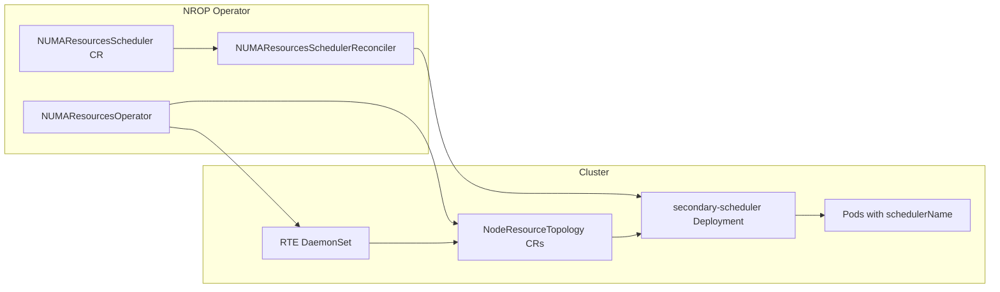

# NUMA Resources Scheduler (NROP Secondary Scheduler)

This guide describes the **NUMAResourcesScheduler** operand managed by the [NUMA Resources Operator](https://github.com/openshift-kni/numaresources-operator): what it is, why it exists, how the operator manages it, how to interact with it on a cluster, and how the scheduler-focused E2E tests validate that behavior.

For the OCPBUGS-79418 topology-spread fix (background, rollout constraints, and release context), see [OCPBUGS-79418 Scheduler Deployment Spread — Technical Document](ocpbugs-79418-scheduler-topology-spread.md) and the [manual E2E test plan](ocpbugs-79418-scheduler-spread-test-plan.md).

---

## Table of contents

1. [What the NROP scheduler is](#1-what-the-nrop-scheduler-is)
2. [Why it exists](#2-why-it-exists)
3. [What the operator does](#3-what-the-operator-does)
4. [How to interact with the scheduler](#4-how-to-interact-with-the-scheduler)
5. [E2E test catalog (`test/e2e/sched/`)](#5-e2e-test-catalog-teste2esched)
6. [Running scheduler E2E tests](#6-running-scheduler-e2e-tests)
7. [Related documentation](#7-related-documentation)

---

## 1. What the NROP scheduler is

The **NUMAResourcesScheduler** (NRS) is a **cluster-scoped singleton** custom resource. The object name must be `numaresourcesscheduler` (enforced by API validation).

| Aspect | Detail |
|--------|--------|
| API group / kind | `nodetopology.openshift.io/v1`, `NUMAResourcesScheduler` |
| Short name | `numaressched` |
| Controller | [`NUMAResourcesSchedulerReconciler`](../internal/controller/numaresourcesscheduler_controller.go) |
| Workload deployed | `kube-scheduler` as a **secondary scheduler** (not the cluster default scheduler) |
| Deployment name | `secondary-scheduler` in namespace `openshift-numaresources` (when installed via NROP) |
| Scheduling plugin | **NodeResourceTopologyMatch** ([`SchedulerPluginName`](../pkg/numaresourcesscheduler/objectstate/sched/sched.go)) |

The scheduler reads **NodeResourceTopology** (NRT) objects produced by the Resource Topology Exporter (RTE), which NROP deploys via the **NUMAResourcesOperator** CR. Together, RTE + NRT + the secondary scheduler enable **NUMA-topology-aware placement** for workloads that opt in via `spec.schedulerName`.



---

## 2. Why it exists

**Problem:** The default Kubernetes scheduler does not use per-NUMA capacity and topology from RTE when placing pods that need strict NUMA alignment.

**Role of NROP:** The operator provides **minimal lifecycle management** for the [scheduler-plugins](https://github.com/openshift-kni/scheduler-plugins) / [Topology Aware Scheduling working group](https://github.com/k8stopologyawareschedwg) stack: image, configuration, RBAC, Deployment, HA replicas, and status until these components move upstream (see [README roadmap](../README.md)).

**High availability:** On multi-node clusters the operator can run multiple scheduler pods (up to three) with **leader election** when `replicas > 1`, so scheduling continues if a control-plane (or HyperShift worker) node is unavailable.

**Spread safety:** Scheduler pods are spread across nodes using **topology spread constraints** (not required `podAntiAffinity`) so multiple replicas do not pile onto one node—see [OCPBUGS-79418 technical doc](ocpbugs-79418-scheduler-topology-spread.md).

**Workload requirements:** Meaningful NUMA alignment applies to **Guaranteed QoS** pods with integral CPU requests; see [README limitations](../README.md) on NRT CPU accounting.

---

## 3. What the operator does

Reconciliation is driven by the NRS CR spec and cluster topology. The controller does not implement scheduling logic itself; it keeps cluster objects aligned with the desired scheduler deployment.

| Concern | Behavior | Primary source |
|---------|----------|----------------|
| Deploy / update | Deployment, ServiceAccount, RBAC, ConfigMap, NetworkPolicy | [`pkg/numaresourcesscheduler/manifests/`](../pkg/numaresourcesscheduler/manifests/) |
| Replica count | **Autodetect** when `spec.replicas` is unset: count schedulable role nodes, cap at **3**, prefer **odd** count when fewer than 3 nodes | `computeSchedulerReplicas()` in [controller](../internal/controller/numaresourcesscheduler_controller.go) |
| Platform | **OpenShift:** control-plane nodes (`node-role.kubernetes.io/control-plane`). **HyperShift:** worker nodes | Same function |
| Explicit replicas | User may set `0`–N; values **greater than** schedulable role node count fail reconcile → **Degraded** | Controller + status |
| Topology spread | `MaxSkew: 1`, `kubernetes.io/hostname`, `DoNotSchedule`, `MatchLabelKeys: pod-template-hash` | [`DeploymentTopologySpreadConstraints()`](../pkg/objectupdate/sched/sched.go) |
| Drift correction | Manual edits to owned ConfigMap or Deployment pod template are reverted | E2E: “owned objects changes” |
| Plugin config | Scheduler profile in ConfigMap (cache resync, scoring, informer mode, etc.) | [`SchedulerConfig()`](../pkg/objectupdate/sched/sched.go) |
| Status | `Available`, `Upgradeable`, `Degraded`, `Progressing`; `status.schedulerName`, `status.deployment`, `status.cacheResyncPeriod` | [`NUMAResourcesSchedulerStatus`](../api/v1/numaresourcesscheduler_types.go) |

### Replica autodetection (summary)

When `spec.replicas` is **nil**:

1. List nodes with the platform-appropriate role label.
2. If count is **0**, reconcile fails.
3. If count **> 3**, use **3** replicas.
4. If count **< 3**, use **1** replica (odd-size preference for split-brain avoidance on small clusters).

When `spec.replicas` is set, it must be **≤** the number of schedulable role nodes; otherwise the controller returns an error and the CR becomes **Degraded**.

### Deployment placement preference

The scheduler Deployment template uses **preferred** node affinity for control-plane nodes and tolerations for control-plane taints. That is a **soft** preference: if no control-plane is schedulable, the default scheduler may still place pods on workers (validated by E2E 79418-05).

---

## 4. How to interact with the scheduler

### 4.1 Install and inspect the NUMAResourcesScheduler CR

Example manifests live under [`doc/examples/`](../doc/examples/):

| File | Purpose |
|------|---------|
| [`sched.yaml`](../doc/examples/sched.yaml) | Basic install with custom image, log level, scheduler name, HA replicas |
| [`sched.ha.yaml`](../doc/examples/sched.ha.yaml) | HA configuration (`replicas: 3`) |
| [`sched.debug.yaml`](../doc/examples/sched.debug.yaml) | Trace logging + cache resync debug dump |
| [`sched.nocache.yaml`](../doc/examples/sched.nocache.yaml) | Cache resync disabled |

Minimal example:

```yaml
apiVersion: nodetopology.openshift.io/v1
kind: NUMAResourcesScheduler
metadata:
  name: numaresourcesscheduler
spec:
  imageSpec: "quay.io/openshift-kni/scheduler-plugins:5.0-snapshot"
  logLevel: "Normal"
  schedulerName: "topo-aware-scheduler"
```

#### Spec fields (common)

| Field | Description |
|-------|-------------|
| `spec.imageSpec` | Scheduler container image (kube-scheduler + plugins) |
| `spec.schedulerName` | Scheduler **profile name** in the kube-scheduler config; also drives `status.schedulerName` used by workloads |
| `spec.replicas` | Optional. **Unset (nil)** = autodetect. **`0`** = scale Deployment to zero. **1–N** = explicit count, bounded by schedulable role nodes |
| `spec.logLevel` | `Normal`, `Debug`, `Trace`, `TraceAll` |
| `spec.cacheResyncPeriod` | Cache resync interval; explicit `0` disables resync |
| `spec.cacheResyncDebug` | `Disabled` or `DumpJSONFile` (default) |
| `spec.cacheResyncDetection` | `Relaxed` or `Aggressive` pod-driven resync |
| `spec.schedulerInformer` | `Shared` or `Dedicated` (default) apiserver informer for the plugin |
| `spec.scoringStrategy` | `MostAllocated`, `BalancedAllocation`, or `LeastAllocated` |

**Important:** Workloads use **`status.schedulerName`** (observed name after reconcile), not necessarily the same string as `spec.schedulerName` if the operator normalizes or overrides it.

#### CLI examples

```bash
# Inspect singleton CR and conditions
oc get numaresourcesscheduler numaresourcesscheduler -o yaml
oc get numaresourcesscheduler numaresourcesscheduler -o jsonpath='{.status.schedulerName}{"\n"}'
oc get numaresourcesscheduler numaresourcesscheduler -o jsonpath='{range .status.conditions[*]}{.type}={.status} {.reason}{"\n"}{end}'

# Scheduler Deployment and pods
oc -n openshift-numaresources get deploy,po -l app=secondary-scheduler
oc -n openshift-numaresources logs deploy/secondary-scheduler -c secondary-scheduler

# Patch scheduler image (operator reconciles Deployment)
oc patch numaresourcesscheduler numaresourcesscheduler --type=merge \
  -p '{"spec":{"imageSpec":"quay.io/openshift-kni/scheduler-plugins:5.0-snapshot"}}'

# Set explicit replica count
oc patch numaresourcesscheduler numaresourcesscheduler --type=merge \
  -p '{"spec":{"replicas":2}}'

# Return to autodetect: remove replicas field (e.g. oc edit, or merge patch with null)
oc edit numaresourcesscheduler numaresourcesscheduler
```

Apply a sample CR:

```bash
oc apply -f doc/examples/sched.yaml
```

### 4.2 Schedule workloads with the secondary scheduler

Pods (or pod templates in Deployments, Jobs, etc.) must set **`spec.schedulerName`** to the value published in **`status.schedulerName`**.

Example from [`doc/examples/pod.numalign.yaml`](../doc/examples/pod.numalign.yaml):

```yaml
apiVersion: v1
kind: Pod
metadata:
  generateName: numalign-pod-
spec:
  schedulerName: topo-aware-scheduler
  containers:
  - name: numalign
    image: quay.io/fromani/numalign
    resources:
      limits:
        cpu: 1
        memory: 256Mi
      requests:
        cpu: 1
        memory: 256Mi
```

Verify a pod was scheduled by this scheduler (conceptually):

```bash
SCHED=$(oc get numaresourcesscheduler numaresourcesscheduler -o jsonpath='{.status.schedulerName}')
oc get pod <pod-name> -o jsonpath='{.spec.schedulerName}{"\n"}'   # should match $SCHED
oc describe pod <pod-name> | grep -A2 "Events"                        # check binding / scheduling
```

**Workload-level E2E** (placement success, alignment failures, scheduler name changes) lives in [`test/e2e/serial/`](../test/e2e/serial/)—for example [`configuration.go`](../test/e2e/serial/tests/configuration.go) and [`scheduler_removal.go`](../test/e2e/serial/tests/scheduler_removal.go). Those tests validate end-to-end scheduling behavior, not operator reconciliation of the scheduler Deployment.

### 4.3 Uninstall

Delete the singleton CR; the operator removes owned scheduler resources:

```bash
oc delete numaresourcesscheduler numaresourcesscheduler
```

The uninstall E2E suite verifies that manifest objects in the scheduler namespace are gone within five minutes.

---

## 5. E2E test catalog (`test/e2e/sched/`)

Ginkgo suites are labeled **`[Scheduler]`**. Files:

| Package | File |
|---------|------|
| Main updates + spread | [`sched_test.go`](../test/e2e/sched/sched_test.go) |
| Spread helpers | [`sched_spread_helpers_test.go`](../test/e2e/sched/sched_spread_helpers_test.go) |
| Install | [`install/install_test.go`](../test/e2e/sched/install/install_test.go) |
| Uninstall | [`uninstall/uninstall_test.go`](../test/e2e/sched/uninstall/uninstall_test.go) |

Shared behavior in **`sched_test.go`**: outer `BeforeEach` loads the cluster NRS CR and **`DeferCleanup`** restores `spec` after each test so the cluster returns to its prior configuration.

---

### 5.1 Install suite

**Describe:** `[Scheduler] install`  
**File:** [`test/e2e/sched/install/install_test.go`](../test/e2e/sched/install/install_test.go)

| Test ID | Name | Labels | What it verifies | Key actions |
|---------|------|--------|------------------|-------------|
| **48598** | should perform the scheduler deployment and verify it is reported as available with healthy conditions | Tier2 | Fresh NRS install: healthy operator status, Deployment ready, pods on control-plane, replica count matches CP nodes, CRD present | `Create` NRS; wait `Available=True`, not Degraded/Progressing; Deployment `ReadyReplicas == spec.replicas`; each pod `nodeName` in CP set; `replicas == len(control-plane nodes)`; NRS CRD exists |

---

### 5.2 Scheduler object updates

**Describe:** `[Scheduler] scheduler object updates`  
**File:** [`test/e2e/sched/sched_test.go`](../test/e2e/sched/sched_test.go)

#### Context: `with a running cluster with all the components`

| Test ID | Name | Labels | What it verifies | Key actions |
|---------|------|--------|------------------|-------------|
| — | should be able to handle plugin image change without remove/rename | — | Changing `spec.imageSpec` updates Deployment image without replacing the CR UID; revert completes rollout | Patch image to CI test image; assert container image; revert spec; wait Deployment complete |
| — | should react to owned objects changes | — | Operator reverts tampering on owned ConfigMap and Deployment | Add key to owned ConfigMap → reverted; append container / change hostname on Deployment → pod template reverted |
| — | should reflect changes in cacheResyncPeriod when configured | — | `cacheResyncPeriod` flows to status, ConfigMap scheduler profile, and triggers new pods | Patch `spec.cacheResyncPeriod`; assert status + ConfigMap `resyncPeriodSeconds`; wait new pod UIDs after rollout |

---

#### When: `testing deployment TopologySpreadConstraints`

**Labels:** `Tier0`, `feature:schedspread`, `OCPBUGS-79418`  
**Manual test plan mapping:** [TP-79418-01 … TP-79418-07](ocpbugs-79418-scheduler-spread-test-plan.md)

**Shared `BeforeEach`:**

- If `spec.replicas` was explicit, reset to **nil** (autodetect) and wait for Deployment (caps at 3 replicas on large clusters).
- Assert Deployment **`topologySpreadConstraints`** match expected shape (`MaxSkew: 1`, hostname, `DoNotSchedule`, `pod-template-hash`) — covers manual **TP-79418-02** (constraints on template).
- Record `autoDetectedReplicasCount` from Deployment.

**Helpers** ([`sched_spread_helpers_test.go`](../test/e2e/sched/sched_spread_helpers_test.go)): `countSchedulerRoleNodes`, `expectedTopologySpreadConstraintsForDeployment`, `expectSchedulerPodsSpreadOnDistinctNodes`, `expectNRSDegradedContaining`, `expectNRSNotDegraded`, `cordonNode`, `uncordonNode`, `countDedicatedWorkerNodes`, `nodeHasWorkerRoleOnly`.

| Test ID | Name | Labels | Manual TP | What it verifies | Skips / prerequisites |
|---------|------|--------|-----------|------------------|------------------------|
| **79418-02** | should not configure required podAntiAffinity for spread | — | (anti-affinity regression) | No **required** `podAntiAffinity` rules; spread uses `topologySpreadConstraints` only | — |
| **79418-01** | should have each replica running on a different node | — | TP-79418-01 | Each Running scheduler pod has unique `nodeName` | Needs ≥1 replica |
| **79418-04** | should report Degraded when explicit replicas exceed schedulable node count | Tier1 | TP-79418-04 | `spec.replicas = nodeCount+1` → Degraded with expected message; Deployment **not** scaled to invalid count; autodetect restores health | — |
| **79418-06** | should preserve spread across nodes after scheduler image rollout | Tier1 | TP-79418-06 | After image change and rollout, constraints unchanged and pods still on distinct nodes | Skip if `< 2` replicas or already on CI test image |
| **79418-07** | should restore topology spread constraints when removed from Deployment | Tier1 | TP-79418-07 | Clearing constraints on Deployment is reverted by operator; distinct nodes if ≥2 replicas | — |
| — | should allow updating replicas to 0 and properly switch back to autodetection mode | — | (replica lifecycle) | `replicas: 0` → no Running pods; `replicas: nil` → autodetected count Running | — |
| — | should allow updating replicas and keep deployment the same when explicit replicas count set similar to autodetected count | — | (no unnecessary rollout) | Explicit count == autodetected: Deployment UID/generation unchanged for 2 min; same after revert to nil | — |
| — | should allow updating replicas to 1 and have pods running properly | — | (single-replica mode) | `replicas: 1` → one Running pod; autodetect restores full count | Skip if autodetected count already `1` |
| **79418-05** | should schedule recreated pod on a worker when its control-plane node is unavailable | disruptive, Tier1, **Serial** | TP-79418-05 | Cordon CP node hosting a pod; delete pod; replacement Runs on **worker-only** node; spread preserved | **OpenShift only**; ≥**3** replicas; ≥1 dedicated worker |
| **79418-03** | should keep the associated pod pending when deleted for balanced spread | disruptive, **Serial** | TP-79418-03 | Cordons nodes so spread cannot be satisfied; deleted pod stays **Pending** with topology spread message; uncordon → Running | Multi-node cluster; needs enough replicas spread on distinct nodes |

**Not automated in `test/e2e/sched/`** (see [manual test plan](ocpbugs-79418-scheduler-spread-test-plan.md)): TP-79418-08 (two CP → single replica), TP-79418-09 (≥4 CP → cap 3), TP-79418-10 (HyperShift workers), TP-79418-11 (customer explicit-replica workaround).

---

### 5.3 Uninstall suite

**Describe:** `[Scheduler] uninstall`  
**File:** [`test/e2e/sched/uninstall/uninstall_test.go`](../test/e2e/sched/uninstall/uninstall_test.go)

| Test ID | Name | What it verifies | Key actions |
|---------|------|------------------|-------------|
| — | should delete all components after NROScheduler deletion | All scheduler manifest objects become NotFound | Delete NRS CR; poll each object from scheduler manifests until gone (5 min) |

---

### 5.4 Related tests (out of scope for this catalog)

| Location | Focus |
|----------|--------|
| [`test/e2e/serial/tests/configuration.go`](../test/e2e/serial/tests/configuration.go) | Scheduler name in status, pods scheduled with topology-aware scheduler, scheduling failures |
| [`test/e2e/serial/tests/scheduler_removal.go`](../test/e2e/serial/tests/scheduler_removal.go) | Deployments using scheduler name when scheduler is removed |
| [`internal/controller/numaresourcesscheduler_controller_test.go`](../internal/controller/numaresourcesscheduler_controller_test.go) | Unit: replica computation, spread on reconcile, invalid replicas |
| [`pkg/objectupdate/sched/sched_test.go`](../pkg/objectupdate/sched/sched_test.go) | Unit: `DeploymentTopologySpreadConstraints` shape |

---

## 6. Running scheduler E2E tests

See [README.tests.md](../README.tests.md) for cluster prerequisites (kubeletconfig, operator installed, NRO + NRS CRs).

The suite expects a **pre-installed** operator; install/uninstall tests create or delete the NRS CR as part of the test.

Example focuses (from developer workflows):

```bash
# All scheduler package tests
ginkgo -focus '\[Scheduler\]'

# Topology spread / OCPBUGS-79418 subset
ginkgo -focus 'schedspread'

# Single test id
ginkgo -focus '79418-01'
```

**Notes:**

- Tests labeled **`disruptive`** cordon nodes or delete scheduler pods; run in isolation (**Serial** contexts).
- Spread tests need **≥2** schedulable role nodes for multi-replica cases; 79418-05 needs **3** replicas on OpenShift with a dedicated worker.
- Use the project’s e2e runner scripts (e.g. [`hack/run-test-serial-e2e.sh`](../hack/run-test-serial-e2e.sh)) when executing from the source tree with `KUBECONFIG` set.

---

## 7. Related documentation

| Document | Content |
|----------|---------|
| [OCPBUGS-79418 technical doc](ocpbugs-79418-scheduler-topology-spread.md) | Spread fix, replica logic, anti-affinity history |
| [OCPBUGS-79418 E2E test plan](ocpbugs-79418-scheduler-spread-test-plan.md) | Manual TP-79418-01 … 11 steps |
| [README.md](../README.md) | Operator overview, roadmap, NRT limitations |
| [README.tests.md](../README.tests.md) | How to run the full e2e suite |
| [doc/examples/](../doc/examples/) | Sample NRO, NRS, kubeletconfig, and workload YAML |
