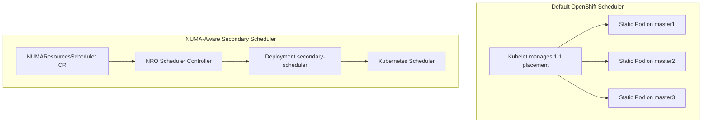
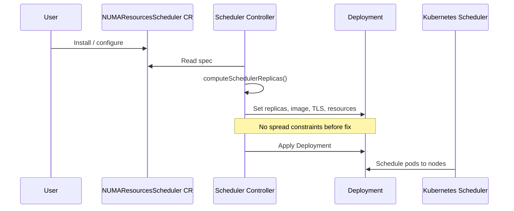
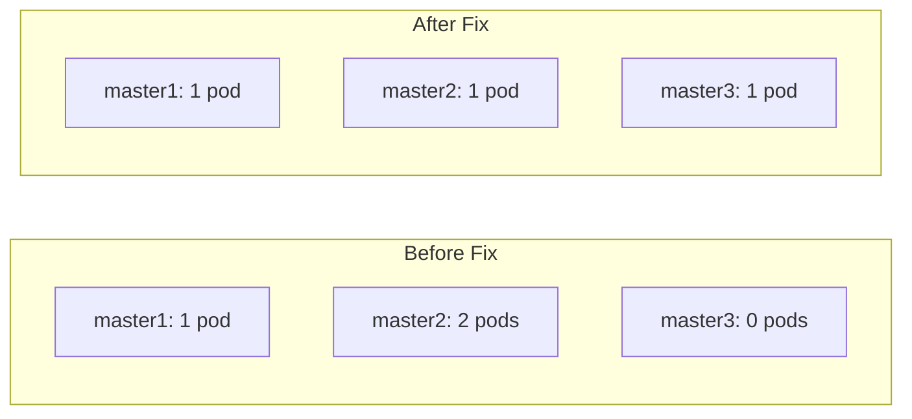

# OCPBUGS-79418: Scheduler Deployment Spread — Technical Document

## Table of Contents

1. [Executive Summary](#1-executive-summary)
2. [Architecture: Two Different Schedulers](#2-architecture-two-different-schedulers)
3. [How the Scheduler Deployment Worked Before the Fix](#3-how-the-scheduler-deployment-worked-before-the-fix)
4. [The Issue (OCPBUGS-79418)](#4-the-issue-ocpbugs-79418)
5. [First Fix Attempt: podAntiAffinity (Failed)](#5-first-fix-attempt-podantiaffinity-failed)
6. [The Shipped Fix](#6-the-shipped-fix)
7. [How the Fix Resolves the Issue](#7-how-the-fix-resolves-the-issue)
8. [Behavior Comparison Table](#8-behavior-comparison-table)
9. [Testing Coverage](#9-testing-coverage)
10. [Release and Backport Context](#10-release-and-backport-context)
11. [Key Takeaways](#11-key-takeaways)
12. [References](#12-references)

**Related:** [E2E Test Plan](ocpbugs-79418-scheduler-spread-test-plan.md) — setup, steps, and expected results for TP-79418-01 through TP-79418-11.

---

## 1. Executive Summary

**Bug:** [OCPBUGS-79418](https://issues.redhat.com/browse/OCPBUGS-79418) — *numa-aware scheduler should use podAntiAffinity for Pod placement*


**Root cause:** The NUMA-aware scheduler runs as a normal Kubernetes **Deployment**. Without topology spread or anti-affinity, the default scheduler may place multiple replicas on one node. Replica count alone does not guarantee one-pod-per-node placement.

**Fix (on `main`):** Not podAntiAffinity (reverted due to rollout deadlocks). The shipped fix uses:

1. **`topologySpreadConstraints`** on the scheduler Deployment (`MaxSkew: 1`, hostname topology, `DoNotSchedule`)
2. **Replica validation** — explicit `spec.replicas` cannot exceed schedulable control-plane/worker nodes
3. **Existing auto-detect logic** — odd-sized HA preference, cap at 3 replicas

**Key commits (chronological):**

| Commit     | Change                                              |
|------------|-----------------------------------------------------|
| `b4e7fd1ab` | Added podAntiAffinity + custom rollout strategy     |
| `c04e8f7f7` | **Reverted** podAntiAffinity                        |
| `9a2cee9f1` | Reject explicit replicas > node count               |
| `e192eb5fc` | Add `topologySpreadConstraints`                     |
| `f30a924e8` | Fix deployment readiness wait with new replica logic |

---

## 2. Architecture: Two Different Schedulers

Understanding the bug requires distinguishing the **default OpenShift scheduler** from the **NUMA-aware secondary scheduler**.



| Aspect | Default scheduler | Secondary (NUMA-aware) scheduler |
|--------|-------------------|----------------------------------|
| Workload type | **Static pods** (manifests on disk) | **Deployment** (ReplicaSet-managed) |
| Placement | Kubelet ensures one per node | Kubernetes scheduler picks nodes |
| Spread mechanism | Implicit (static binding) | Must be configured explicitly |
| Managed by | OpenShift / MCO | numaresources-operator via `NUMAResourcesScheduler` CR |

The customer compared secondary scheduler pods to default scheduler behavior. That comparison is misleading: default scheduler pods never use podAntiAffinity because they are not scheduled pods at all. The customer's concern is still valid for the Deployment-based secondary scheduler.

---

## 3. How the Scheduler Deployment Worked Before the Fix

### 3.1 Control flow



Reconciliation lives in [`internal/controller/numaresourcesscheduler_controller.go`](../internal/controller/numaresourcesscheduler_controller.go) (`syncNUMASchedulerResources`).

### 3.2 Replica computation (unchanged conceptually)

[`computeSchedulerReplicas()`](../internal/controller/numaresourcesscheduler_controller.go) (lines 246–299):

- **Platform-aware node selection:**
  - OpenShift: count nodes with `node-role.kubernetes.io/control-plane`
  - HyperShift: count nodes with `node-role.kubernetes.io/worker`
- **`spec.replicas` unset (auto-detect):**
  - 0 nodes → error (degraded)
  - 1–2 nodes → **1 replica** (odd-size HA preference)
  - 3+ nodes → **min(nodeCount, 3)** (capped at `MaxSchedulerReplicas = 3`, line 67)
- **`spec.replicas` set:** use explicit value (before fix: **no upper bound validation**)

Leader election is enabled when `replicas > 1` ([`configParamsFromSchedSpec`](../internal/controller/numaresourcesscheduler_controller.go), line 440).

### 3.3 Deployment pod template (baseline manifest)

From [`pkg/numaresourcesscheduler/manifests/yaml/deployment.yaml`](../pkg/numaresourcesscheduler/manifests/yaml/deployment.yaml):

- **Preferred** (not required) node affinity to control-plane nodes (lines 24–31)
- Control-plane **tolerations** so pods can run on masters (lines 58–62)
- **No** `podAntiAffinity`
- **No** `topologySpreadConstraints`
- Default Deployment rollout strategy (25% max unavailable, 25% max surge)

**Important nuance:** Node affinity is **preferred**, not required. If control-plane nodes are unavailable, pods *can* schedule on workers. This is intentional for resilience and is exercised in e2e tests.

### 3.4 What “3 replicas” meant before the fix

Before the fix, setting (or auto-detecting) 3 replicas only meant:

> “The Deployment should try to run 3 running pods.”

It did **not** mean:

> “Exactly one pod on each of 3 distinct nodes.”

Kubernetes treats replica count and placement as separate concerns. With no spread constraints, valid placements include:

```
master1: pod-A, pod-B
master2: pod-C
master3: (empty)
```

This matches the customer’s `oc get pods -o wide` output.

### 3.5 When colocation is most visible

- **Steady cluster:** Scheduler may still colocate; placement depends on scheduler scoring, resource availability, and history — not guaranteed spread.
- **Node failure / NotReady:** Auto-detect may still request 3 replicas while only 2 healthy control-plane nodes exist; remaining pods squeeze onto available nodes.
- **Rollouts:** Default RollingUpdate can temporarily create surge pods; without spread rules, new pods need not land on distinct nodes.

---

## 4. The Issue (OCPBUGS-79418)

### 4.1 Reported symptom

```
secondary-scheduler-...-ccblt  → master2
secondary-scheduler-...-db54f  → master1
secondary-scheduler-...-rd828  → master2   ← duplicate on same node
```

**Expected:** At most one scheduler pod per control-plane node (HA best practice).

**Actual:** Multiple replicas on one node; Deployment spec lacked spread rules.

### 4.2 Impact

- **Reduced HA:** Loss of one node can take down multiple scheduler replicas at once.
- **Resource concentration:** Scheduler CPU/memory load stacked on one master.
- **Operational concern:** Does not match expected OpenShift scheduler HA posture (even though implementation differs).

### 4.3 Severity and scope

- **Severity:** Important
- **Affects:** 4.20.z (customer); upstream fix targets 5.0 with backport clones via prow
- **Not observed during upgrade:** Customer found it via spec review, not a live outage

---

## 5. First Fix Attempt: podAntiAffinity (Failed)

### 5.1 What was tried (`b4e7fd1ab`)

Added `DeploymentAffinityWithStrategy()` in [`pkg/objectupdate/sched/sched.go`](../pkg/objectupdate/sched/sched.go) (later reverted in `c04e8f7f7`):

- **Required** podAntiAffinity on `kubernetes.io/hostname` when `spec.replicas` is nil (auto-detect)
- Custom rollout: `maxUnavailable: 1`, `maxSurge: 0`
- When user sets explicit replicas: **remove** anti-affinity and reset strategy

Rationale: force one pod per host in auto-detect mode while leaving manual replica mode unconstrained.

### 5.2 Why it was reverted (`c04e8f7f7`)

Documented in Jira comment (May 19, 2026):

**Deadlock scenario:**

1. Auto-detection sets replicas = number of control-plane nodes (e.g. 3)
2. Admin manually sets `spec.replicas` ≥ auto-detected count
3. Rollout + anti-affinity interaction causes **new pods Pending forever**

Additional problems:

- Mixing anti-affinity with Deployment rollouts is fragile (old + new ReplicaSet pods compete for hostname constraints)
- Conditional anti-affinity (only in auto-detect) creates inconsistent behavior
- Changing rollout strategy globally for the Deployment has side effects

**Workaround communicated to customer:** Manually set `spec.replicas: 2` when one master is down; unset to restore auto-detect when node returns.

---

## 6. The Shipped Fix

The fix is a **three-part** change on `main`.

### 6.1 Part A: TopologySpreadConstraints (`e192eb5fc`)

Implemented in [`DeploymentTopologySpreadConstraints()`](../pkg/objectupdate/sched/sched.go) (lines 106–128):

```go
schedConstr := corev1.TopologySpreadConstraint{
    LabelSelector:     &metav1.LabelSelector{MatchLabels: labels},
    MaxSkew:           1,
    TopologyKey:       "kubernetes.io/hostname",
    WhenUnsatisfiable: corev1.DoNotSchedule,
    MatchLabelKeys:    []string{"pod-template-hash"},
}
```

Wired in controller (lines 367–369):

```go
if err := schedupdate.DeploymentTopologySpreadConstraints(r.SchedulerManifests.Deployment); err != nil {
    return nropv1.NUMAResourcesSchedulerStatus{}, err
}
```

**Why TopologySpreadConstraints instead of podAntiAffinity:**

| Concern | podAntiAffinity | TopologySpreadConstraints |
|---------|-----------------|---------------------------|
| Goal | Avoid same hostname | Even spread with bounded skew |
| Rollout safety | Poor (counts all matching pods) | Better with `MatchLabelKeys: pod-template-hash` |
| Pending behavior | Hard required rules → deadlock | `DoNotSchedule` when spread impossible |
| HA semantics | Binary per-host exclusion | MaxSkew=1 → at most one pod ahead on any host |

`MatchLabelKeys: pod-template-hash` is critical: during rollout, spread is computed **per ReplicaSet**, so old pods do not block new pods from balancing on the new ReplicaSet (see [Kubernetes deployment docs](https://kubernetes.io/docs/concepts/workloads/controllers/deployment/#pod-template-hash-label)).

### 6.2 Part B: Replica upper-bound validation (`9a2cee9f1`)

In [`computeSchedulerReplicas()`](../internal/controller/numaresourcesscheduler_controller.go) (lines 274–279):

```go
if schedSpec.Replicas != nil {
    if *schedSpec.Replicas > replicaCount {
        return nil, fmt.Errorf("explicitly set replicas count should not be greater than the number of the nodes with role %s", nodeRoleDescription)
    }
    return schedSpec.Replicas, nil
}
```

Controller surfaces this as **Degraded** status. Prevents meaningless HA configs (e.g. 5 replicas on 3 nodes) that would always leave pods Pending under spread constraints.

### 6.3 Part C: Deployment readiness fix (`f30a924e8`)

Supporting change so e2e/operator correctly waits for Deployment completion under the new spread + replica behavior.

---

## 7. How the Fix Resolves the Issue

### 7.1 Steady-state cluster (3 control-planes, auto-detect)



- Auto-detect still sets replicas = 3
- Topology spread enforces **MaxSkew 1** across hostnames
- E2e verifies: [`It("should have each replica running on a different node")`](../test/e2e/sched/sched_test.go) (line 373)

### 7.2 Control-plane node down

When a node hosting a scheduler pod fails and the pod is deleted:

| Cluster type | Behavior |
|--------------|----------|
| **Compact** (no schedulable workers) | Replacement pod stays **Pending** — spread cannot be satisfied; message references topology spread constraints |
| **With workers** | Pod **may schedule on a worker** (preferred node affinity is soft); better than losing the replica entirely |

E2e covers compact case: [`When("one host of a scheduler pod is down")`](../test/e2e/sched/sched_test.go) (line 521) — recreated pod Pending with `"didn't match pod topology spread constraints"` (line 629).

### 7.3 Explicit replica changes

Still supported and tested:

- Set replicas to 0, then back to auto-detect (line 386)
- Set explicit count equal to auto-detected count (no unnecessary rollout, line 437)
- Set replicas to 1 (line 470)
- **Rejected:** explicit count > node count (unit tests only; see section 9)

### 7.4 Rollouts

Spread uses `pod-template-hash` so rolling updates do not deadlock the way podAntiAffinity did. New ReplicaSet pods spread among available nodes without fighting old ReplicaSet pods for anti-affinity slots.

---

## 8. Behavior Comparison Table

| Scenario | Before fix | After fix |
|----------|------------|-----------|
| 3 CP nodes, auto-detect | 3 replicas; may colocate | 3 replicas; max 1 per node |
| 2 healthy CP, 1 down, auto-detect | 3 desired; colocation likely | Spread + pending/worker fallback |
| Explicit replicas > nodes | Accepted | **Degraded** error |
| Explicit replicas = node count | Accepted | Accepted; spread enforced |
| Deployment rollout | Default strategy | Default strategy + spread |
| Default OpenShift scheduler | 1 static pod/node | Unchanged (different mechanism) |

---

## 9. Testing Coverage

See the dedicated **[E2E Test Plan](ocpbugs-79418-scheduler-spread-test-plan.md)** for step-by-step setup, test actions, and expected outputs (Tier 0–2, TP-79418-01 through TP-79418-11).

For a full catalog of all `[Scheduler]` E2E specs (install, object updates, spread, uninstall), see **[NUMA Resources Scheduler guide](numaresources-scheduler.md#5-e2e-test-catalog-teste2esched)**.

| Layer | File | What it validates |
|-------|------|-------------------|
| Unit | [`pkg/objectupdate/sched/sched_test.go`](../pkg/objectupdate/sched/sched_test.go) | TopologySpreadConstraints shape (`TestDeploymentTopologySpreadConstraints`, line 649) |
| Unit | [`internal/controller/numaresourcesscheduler_controller_test.go`](../internal/controller/numaresourcesscheduler_controller_test.go) | Spread on reconcile (line 1034); replica compute; explicit replica bounds (line 1130) |
| E2E | [`test/e2e/sched/sched_test.go`](../test/e2e/sched/sched_test.go) | Spread across nodes; replica transitions; node failure → Pending; recovery (line 285) |

### E2E tests in detail (`When("testing deployment TopologySpreadConstraints")`)

| Test | Lines | Validates |
|------|-------|-----------|
| BeforeEach: spread constraints on Deployment | 354–367 | `MaxSkew: 1`, hostname topology, `DoNotSchedule`, `pod-template-hash` |
| Each replica on a different node | 373–384 | Steady-state spread (core bug fix) |
| Replicas 0 → autodetect | 386–435 | Scale down/up without breaking spread |
| Explicit replicas = autodetected | 437–468 | No unnecessary Deployment rollout |
| Explicit replicas = 1 | 470–519 | Single-replica mode (skipped on 1-node clusters) |
| Node down: pod stays Pending | 521–648 | Compact cluster; spread constraint message; recovery after uncordon |

Jira verification notes (Jun 2, 2026) reference e2e at [`sched_test.go#L285`](../test/e2e/sched/sched_test.go).

### Coverage gaps (not yet in E2E)

Automated in [`test/e2e/sched/sched_test.go`](../test/e2e/sched/sched_test.go) with test IDs **79418-04** through **79418-07** (see [scheduler guide](numaresources-scheduler.md#when-testing-deployment-topologyspreadconstraints)). Still manual / not in `test/e2e/sched/`:

- HyperShift worker-based replica autodetection (TP-79418-10)
- Two control-plane autodetect single replica (TP-79418-08)
- Four+ control-plane replica cap (TP-79418-09)
- Customer explicit-replica workaround (TP-79418-11)

---

## 10. Release and Backport Context

| Jira | Version | Status (as of document date) | Notes |
|------|---------|------------------------------|-------|
| [OCPBUGS-79418](https://issues.redhat.com/browse/OCPBUGS-79418) | Upstream / 5.0 | MODIFIED | Original bug; affects 4.20.z |
| [OCPBUGS-85702](https://issues.redhat.com/browse/OCPBUGS-85702) | 4.22 | MODIFIED | Cloned from 79418; PR #4026 referenced (pre-topology-spread approach) |
| [OCPBUGS-86859](https://issues.redhat.com/browse/OCPBUGS-86859) | 4.21 | New | Fix Version 4.21.z |

- **Upstream target:** 5.0 (mainline)
- **Backport process:** Prow automation creates cloned bugs per release (4.22 → … → 4.20.z)
- **Fix on branch:** `ocpbugs-79418-scheduler-topology-spread` — identical to `main`; fix already merged upstream

---

## 11. Key Takeaways

1. **Replica count ≠ placement.** A Deployment with 3 replicas does not imply 3 distinct nodes without spread rules.
2. **Secondary scheduler ≠ default scheduler.** Static default scheduler pods achieve 1:1 placement via kubelet; secondary scheduler needs explicit Kubernetes scheduling constraints.
3. **podAntiAffinity was the wrong tool** for this operator due to rollout + auto-detect interactions.
4. **TopologySpreadConstraints with `MatchLabelKeys`** is the correct, rollout-safe mechanism for balanced hostname spread.
5. **Replica validation** prevents configurations that cannot be satisfied under spread rules.

---

## 12. References

- E2E test plan: [`docs/ocpbugs-79418-scheduler-spread-test-plan.md`](ocpbugs-79418-scheduler-spread-test-plan.md)
- Jira: [OCPBUGS-79418](https://issues.redhat.com/browse/OCPBUGS-79418)
- Controller: [`internal/controller/numaresourcesscheduler_controller.go`](../internal/controller/numaresourcesscheduler_controller.go)
- Spread helper: [`pkg/objectupdate/sched/sched.go`](../pkg/objectupdate/sched/sched.go)
- Deployment manifest: [`pkg/numaresourcesscheduler/manifests/yaml/deployment.yaml`](../pkg/numaresourcesscheduler/manifests/yaml/deployment.yaml)
- E2E tests: [`test/e2e/sched/sched_test.go`](../test/e2e/sched/sched_test.go)
- Kubernetes: [Deployment pod-template-hash](https://kubernetes.io/docs/concepts/workloads/controllers/deployment/#pod-template-hash-label)
- Key PRs (historical): #3334, #4021, #4084 (closed); topology spread landed via commits `9a2cee9f1`, `e192eb5fc`, `f30a924e8`
