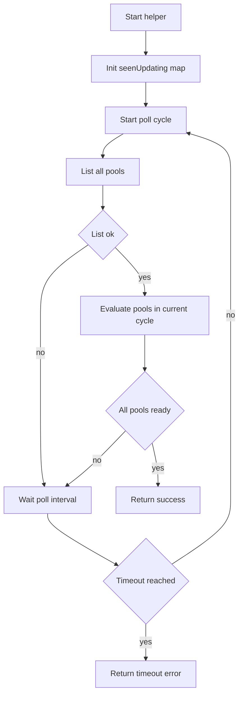
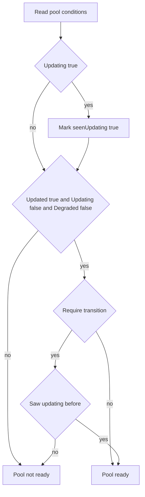

# NROP E2E Test Automation Guide

A practical guide for writing end-to-end tests in the
[numaresources-operator](https://github.com/openshift-kni/numaresources-operator) (NROP) project.


## Project Overview

The NROP project manages topology-aware scheduling (TAS) on Kubernetes/OpenShift clusters. It consists of:

- **NUMAResourcesOperator** (NRO) — deploys the Resource Topology Exporter (RTE) as DaemonSets, manages MachineConfigs for kubelet alignment, and publishes `NodeResourceTopology` (NRT) objects.
- **NUMAResourcesScheduler** — deploys a secondary scheduler that reads NRT data to place pods on NUMA-aligned nodes.
- **RTE** — per-node agent that discovers NUMA topology via the kubelet Pod Resources API and publishes NRT objects.


## Key Concepts

### NodeResourceTopology (NRT) Objects

NRT is shorthand for `NodeResourceTopology`, a **cluster-scoped** Kubernetes Custom Resource in API group `topology.node.k8s.io`. Each NRT object is named after its node's hostname and describes the hardware and resource topology of that node so the topology-aware scheduler can make NUMA-aligned placement decisions.

The Go type is defined in the vendored `noderesourcetopology-api` package:

```go
type NodeResourceTopology struct {
    metav1.TypeMeta   `json:",inline"`
    metav1.ObjectMeta `json:"metadata,omitempty"`

    TopologyPolicies []string      `json:"topologyPolicies,omitempty"`
    Zones            ZoneList      `json:"zones"`
    Attributes       AttributeList `json:"attributes,omitempty"`
}
```

Key nested structures:

- **Zones** (`ZoneList`) — a list of `Zone` entries, each with `Name`, `Type`, `Parent`, `Costs`, zone-level `Attributes`, and **Resources** (per-resource `Capacity`, `Allocatable`, `Available`).
- **Attributes** (`AttributeList`) — key-value pairs carrying metadata such as `topologyManagerPolicy`, `topologyManagerScope`, and the pods fingerprint.

| Property | Value |
|---|---|
| API group | `topology.node.k8s.io` |
| Kind | `NodeResourceTopology` |
| Scope | Cluster (one per node, named after hostname) |
| Short name | `node-res-topo` |

### RTE and NRT: Producer–Consumer Relationship

The **Resource Topology Exporter (RTE)** runs as a DaemonSet pod on every worker node and is the sole **producer** of NRT objects. The **topology-aware scheduler** is the primary **consumer**.

```
┌──────────────┐      PodResources       ┌───────────┐    Create/Update    ┌───────────┐
│   kubelet    │ ──── gRPC List ────────► │  RTE pod  │ ─────────────────► │ NRT (CR)  │
│  (per node)  │                          │ (per node)│                    │ (per node)│
└──────────────┘                          └───────────┘                    └─────┬─────┘
                                                                                │
                                                                          Watch/List
                                                                                │
                                                                     ┌──────────▼──────────┐
                                                                     │ Topology-aware      │
                                                                     │ scheduler plugin    │
                                                                     │ (NodeResourceTopo-  │
                                                                     │  logyMatch)         │
                                                                     └─────────────────────┘
```

| Component | Role |
|---|---|
| RTE pod (per node) | Reads kubelet PodResources API, computes per-NUMA-zone availability, creates/updates the node's NRT object |
| Topology-aware scheduler | Watches NRT objects to decide which node and NUMA zone can satisfy a pod's resource request |
| NRO operator | Ensures the NRT CRD exists and deploys the RTE DaemonSet with the correct flags |

(how-nrt-objects-are-updated)=
### How NRT Objects Are Updated

NRT updates follow a **poll-on-wake** model. RTE does **not** watch pod lifecycle events directly. Instead, it is woken up by a trigger, re-reads the kubelet PodResources API, recomputes availability, and writes the result to the NRT object.

**Update pipeline when a pod is deleted:**

1. **Kubelet frees resources** — the pod's CPUs, memory, and devices are deallocated. The kubelet's PodResources gRPC socket (`/var/lib/kubelet/pod-resources/kubelet.sock`) stops listing that pod's allocations.

2. **RTE wakes up** — via one of two mechanisms, controlled by `InfoRefreshMode` on the NRO CR:

   | `InfoRefreshMode` | Wake-up mechanism | RTE flag |
   |---|---|---|
   | `Periodic` (default in v1) | Timer fires every `InfoRefreshPeriod` | `--sleep-interval` |
   | `Events` | `fsnotify` watch on `/run/rte/notify` — kubelet touches this file when allocations change | `--notify-file` |
   | `PeriodicAndEvents` (default in v1alpha1) | Both timer and fsnotify | both flags |

3. **RTE scans** — calls `ListPodResources` to get the current snapshot of all pod allocations, then computes `Available = Allocatable - Used` per NUMA zone. Since the deleted pod no longer appears in the response, its resources are no longer counted as "used."

4. **RTE updates the NRT object** — performs a `Get` by hostname; if not found, `Create`; otherwise `Update`. The new `Zones` (with updated `Available` values) and `Attributes` are written to the CR. An annotation `RTEUpdate` is set to `"periodic"` or `"reactive"` depending on what triggered the wake-up.

5. **Scheduler sees updated NRT** — the topology-aware scheduler, which watches NRT objects, picks up the new `Available` values and can now consider the freed resources for new pod placements.

**Latency:** There is an inherent delay between pod deletion and the NRT reflecting freed resources. In `Periodic` mode this can be up to one `InfoRefreshPeriod` (e.g. 10 seconds). In `Events` mode it is as fast as kubelet touches the notify file (typically sub-second). The `scheduler_cache.go` tests validate that the scheduler handles this stale-data window correctly.

### Pods Fingerprinting (PFP)

When enabled, RTE computes an order-independent hash of all pod namespace/name pairs seen in the PodResources response and stores it as an NRT attribute (`topologyManagerPodFingerprintAttribute`). When a pod is deleted, the fingerprint changes. Consumers (like the scheduler cache) use this to detect pod-set changes without examining individual resource quantities — useful for cache invalidation and staleness detection.

PFP has two methods:
- **`ExclusiveResources`** — only hash pods that have NUMA-local exclusive resources (the default when enabled).
- **`All`** — hash all pods reported by PodResources.

### The Scheduler Cache

The topology-aware scheduler maintains an internal **cache** of per-node, per-NUMA-zone resource availability. When a pod arrives, the scheduler checks this cache to decide which node and NUMA zone can satisfy the pod's resource requests with proper NUMA alignment.

The cache is **populated from NRT objects**. Without NRT data, the scheduler has no idea what resources exist on which NUMA zone. The relationship:

```
NRT object (source of truth from RTE)
  │
  │  scheduler watches NRT
  ▼
Scheduler cache (in-memory copy)
  │
  │  pod arrives → scheduler reads cache
  ▼
Scheduling decision (which node, which NUMA zone)
  │
  │  pod is placed → cache optimistically reserves
  ▼
Cache is now stale (overreserved)
  │
  │  RTE updates NRT → scheduler watches → cache refreshed
  ▼
Cache is accurate again
```

### Overreservation

Because NRT updates are not instantaneous, the scheduler may make placement decisions based on stale data. When the scheduler places a pod, it **optimistically subtracts** the pod's resources from **all** NUMA zones in the cache (it doesn't know which zone kubelet will actually assign). This is called **overreservation**. The cache stays in this overreserved state until RTE publishes an updated NRT object showing the **actual** allocation (which only affects one zone, not all of them).

This means:

- A pod consuming >50% of a NUMA zone's CPUs will appear to consume resources on **all** zones in the scheduler's view until the next NRT update corrects this.
- During a burst of pod creation, only a subset may be scheduled immediately; the rest stay `Pending` until NRT updates arrive and the scheduler retries.
- This is correct and expected behavior.

### Scheduler Cache Tests (`scheduler_cache.go`)

The tests in `test/e2e/serial/tests/scheduler_cache.go` validate the scheduler's behavior under overreservation and resource pressure:

| Test ID | What it validates |
|---|---|
| `test_id:85786` | Sends a burst of pods. Expects the scheduler to place some immediately, keep others pending until NRT updates correct the overreserve, then place the rest (phased scheduling). |
| `test_id:85787` | Same burst pattern but with GU (Guaranteed) interference pods consuming resources alongside the TAS-scheduled payload pods. |
| `test_id:85788` | Same burst pattern but with BU (Burstable) interference pods at higher scale (4 pods per zone, 1-in-5 interference ratio). |
| `test_id:85789` | Verifies that pods which truly cannot fit (device constrained) stay pending **forever**, not just temporarily. |
| `test_id:85790` | Verifies that when a running pod is deleted and resources are freed, the scheduler eventually unblocks a pending pod. |

These tests need NRT topology to:
- **Filter candidate nodes** — find nodes with exactly 2 NUMA zones (the tests assume a symmetric 2-zone layout).
- **Read available CPUs per zone** — to calculate how much each pod should request so that it triggers the overreservation behavior.
- **Verify the update cycle** — confirm that after RTE updates the NRT, the scheduler's cache catches up and pending pods get placed.

### Machine Description and Dynamic Resource Sizing

Different hardware has different core counts and SMT configurations. The tests can't hardcode "request 14 CPUs" because that number depends on the machine. Instead, they describe the **intent** using a `machineDesc` struct and let the sizing logic calculate the actual CPU request from the live NRT data.

```go
type machineDesc struct {
    desiredPodsPerNUMAZone int     // how many test pods should fit on each NUMA zone
    coresPerCPU            int     // hardware threads per physical CPU (e.g. 2 for SMT-2)
    loadFactor             float64 // fraction of zone CPUs each pod should consume (0.0–1.0)
}
```

| Field | Meaning | Example |
|---|---|---|
| `desiredPodsPerNUMAZone` | How many test pods should fit on each NUMA zone | `2` → 2 pods per zone, 4 per node (with 2 zones) |
| `coresPerCPU` | Hardware threads per physical CPU — accounts for SMT/hyperthreading | `2` → each physical CPU has 2 threads (typical SMT-2) |
| `loadFactor` | What fraction of the zone's CPUs each pod should consume | `0.6` → each pod requests 60% of a zone's allocatable CPUs |

The sizing closure uses these parameters together with the actual CPU count from the NRT:

```
machineDesc{coresPerCPU: 2, desiredPodsPerNUMAZone: 2, loadFactor: 0.6}
                    │
                    ▼
        ┌─── closure captures these ───┐
        │                              │
        │  func(cpuNum int64) int64 {  │   ← cpuNum comes from NRT (e.g. 48 cores available)
        │    physCPUs = 48 / 2 = 24    │   ← divide by coresPerCPU to get physical CPUs
        │    perPod   = 24 / 2 = 12    │   ← divide by desiredPodsPerNUMAZone
        │    loaded   = 12 * 0.6 = 7   │   ← apply loadFactor
        │    return   = 7 * 2 = 14     │   ← convert back to cores (what k8s understands)
        │  }                           │
        └──────────────────────────────┘
                    │
                    ▼
            pod requests 14 CPUs
```

Similarly, `interferenceDesc` describes the mix of non-TAS-scheduled pods injected alongside the payload:

```go
type interferenceDesc struct {
    qos   corev1.PodQOSClass // QoS of interference pods (Guaranteed or Burstable)
    ratio int                // 1 every `ratio` pods will be interference (e.g. 2 → every other pod)
}
```

Together, `machineDesc` and `interferenceDesc` let the `DescribeTable` entries parameterize test scenarios (light load + GU interference, heavy load + BU interference, etc.) while keeping the test body generic and hardware-portable.


## E2E Test Suite Layout

The e2e tests live under `test/e2e/`, organized as separate Go test packages, each with its own Ginkgo `RunSpecs`:

| Package | Purpose |
|---------|---------|
| `serial/` | Main suite: full-stack NUMA/scheduler e2e on a TAS-enabled cluster. Serial and disruptive. Specs in `serial/tests/`. |
| `install/` | Operator install and deployment validation. |
| `uninstall/` | Cleanup and uninstall behavior. |
| `upgrade/` | Upgrade path scenarios. |
| `sched/` | Scheduler deployment, image replacement. Nested `sched/install` and `sched/uninstall`. |
| `tools/` | CLI and auxiliary binary smoke tests (`nrovalidate`, `lsplatform`, `mkginkgolabelfilter`). |
| `tls/` | TLS compliance tests: verify the scheduler endpoint adheres to the cluster's TLS profile (positive + negative). Non-disruptive. |
| `rte/` | RTE topology-updater tests (upstream imports). `rte/local/` for local RTE tests. |
| `must-gather/` | Must-gather execution and output validation. |
| `label/` | Shared label constants (not a test binary). |

Shared helpers live under `test/internal/`.


## Import Organization

Group imports in this order:

```go
import (
    // Go standard library
    "context"
    "fmt"
    "time"

    // Kubernetes libraries
    corev1 "k8s.io/api/core/v1"
    "k8s.io/apimachinery/pkg/api/resource"
    "k8s.io/klog/v2"

    // Controller-runtime
    "sigs.k8s.io/controller-runtime/pkg/client"

    // External dependencies (deployer, NRT API, OpenShift API)
    nrtv1alpha2 "github.com/k8stopologyawareschedwg/noderesourcetopology-api/pkg/apis/topology/v1alpha2"

    // NROP internal/pkg packages
    intnrt "github.com/openshift-kni/numaresources-operator/internal/noderesourcetopology"
    "github.com/openshift-kni/numaresources-operator/internal/wait"

    // NROP test packages
    serialconfig "github.com/openshift-kni/numaresources-operator/test/e2e/serial/config"
    e2efixture "github.com/openshift-kni/numaresources-operator/test/internal/fixture"
    e2enrt "github.com/openshift-kni/numaresources-operator/test/internal/noderesourcetopologies"
    "github.com/openshift-kni/numaresources-operator/test/internal/objects"

    // Ginkgo and Gomega (dot-imported)
    . "github.com/onsi/ginkgo/v2"
    . "github.com/onsi/gomega"
)
```


## Test Labels and Tiers

Labels are defined in `test/e2e/label/label.go`. Use Ginkgo `Label()` instead of bracket tags in titles.
Every test **must** have a tier label.

| Tier | Meaning |
|------|---------|
| `tier0` | Critical — must pass always, blocks releases. |
| `tier1` | High priority — core feature validation. |
| `tier2` | Medium priority — extended use cases, edge scenarios. |
| `tier3` | Low priority — non-regressions, slow tests, rare conditions. |

Additional labels: `slow`, `release_critical`, `reboot_required`, `openshift`, `hypershift`.

Feature labels use the `feature:<name>` convention: `feature:wlplacement`, `feature:config`, `feature:unsched`, `feature:nonreg`, `feature:metrics`, `feature:tlscompliance`, etc.

### Feature Topic Registry (`_topics.json`)

All feature topic labels are registered in `internal/api/features/_topics.json`. This file contains a JSON object with a single `"active"` array listing every feature topic used in the E2E suite:

```text
{
  "active": [
    "config",
    "nonreg",
    "hostlevel",
    "wlplacement",
    "tlscompliance",
    ...
  ]
}
```

Each entry corresponds to a Ginkgo label of the form `Label("feature:<topic>")`. The registry serves two purposes:

1. **Test selection** — CI systems filter tests by topic (e.g. `ginkgo --label-filter="feature:tlscompliance"`).
2. **Feature inventory** — the file acts as a machine-readable catalog of all tested features.

When adding a new feature test, register its topic by appending to the `"active"` array.

Example:
```go
var _ = Describe("[serial][disruptive][scheduler] numaresources workload placement",
    Serial,
    Label("disruptive", "scheduler"),
    Label("feature:wlplacement"),
    func() {
        // ...
    })

It("should place a guaranteed pod on the correct node",
    Label(label.Tier1),
    func() {
        // ...
    })
```


## Suite Setup Pattern (Serial Suite)

The serial suite is the primary e2e suite. Its entry point is `test/e2e/serial/e2e_serial_test.go`:

```go
func TestSerial(t *testing.T) {
    RegisterFailHandler(Fail)
    RunSpecs(t, "NUMAResources serial e2e tests", Label("e2e:serial"))
}

var _ = BeforeSuite(func() {
    Expect(e2eclient.ClientsEnabled).To(BeTrue(), "cannot create kubernetes clients")

    ctx := context.Background()
    serialconfig.DumpEnvironment(os.Stderr)
    Expect(serialconfig.CheckNodesTopology(ctx)).Should(Succeed())
    serialconfig.Setup()
    setupExecuted = true
})

var _ = AfterSuite(func() {
    if !setupExecuted {
        return
    }
    serialconfig.Teardown()
})
```

Test spec files are registered via blank imports in this file:
```go
import (
    _ "github.com/openshift-kni/numaresources-operator/test/e2e/serial/tests"
)
```

The suite-wide `E2EConfig` is defined in `test/e2e/serial/config/fixture.go`:
```go
type E2EConfig struct {
    Fixture       *e2efixture.Fixture
    NRTList       nrtv1alpha2.NodeResourceTopologyList
    NROOperObj    *nropv1.NUMAResourcesOperator
    NROSchedObj   *nropv1.NUMAResourcesScheduler
    SchedulerName string
}
```

Access it via the package-level `serialconfig.Config`.


## Key Test Helper Packages

### `test/internal/fixture` (aliased `e2efixture`)

The fixture is the **per-test isolation boundary**. It bundles everything a single test spec needs to run in isolation and clean up after itself: API clients, a dedicated namespace, and an NRT baseline snapshot.

**The `Fixture` struct:**

```go
type Fixture struct {
    Client         client.Client                          // controller-runtime client for CRUD
    K8sClient      *kubernetes.Clientset                   // typed client for subresource ops (logs, events)
    Namespace      corev1.Namespace                        // dedicated namespace for this test
    InitialNRTList nrtv1alpha2.NodeResourceTopologyList    // NRT snapshot taken at test start
    Skipped        bool                                    // set by Skipf so teardown skips cooldown
    IsRebootTest   bool                                    // adjusts cooldown for reboot tests
    avoidCooldown  bool                                    // disables post-test cooldown entirely
}
```

| Function | Purpose |
|----------|---------|
| `Setup(name, nrtList)` | Create a dedicated namespace (with randomized name) and snapshot NRT state. |
| `SetupWithOptions(name, nrtList, options)` | Like `Setup` with flags: `OptionRandomizeName`, `OptionAvoidCooldown`, `OptionStaticClusterData`. |
| `Teardown(fxt)` | Delete the test namespace (cascade-deletes all workloads) and run cooldown. |
| `Cooldown(fxt)` | Wait for NRT objects to settle back to the initial baseline before the next test. |
| `MustSettleNRT(fxt)` | Assert NRT values have been stable for `cooldownThreshold` (default 5) consecutive checks. |
| `Skipf(fxt, fmt, ...)` | Mark fixture as skipped and call `ginkgo.Skip`. |
| `PopNodeName(set)` | Pick a node name from a set (respects `E2E_NROP_TARGET_NODE`). |
| `ListNodeNames(set)` | Return all names as a slice. |
| `By(fmt, ...)` | Thin wrapper around `ginkgo.By` with `fmt.Sprintf`. |
| `GetDeviceType1/2/3Name()` | Return device type names from `E2E_NROP_DEVICE_TYPE_*` env vars (empty if unset). |
| `WaitForPaddingPodsRunning(ctx, fxt, pods)` | Wait for padding pods, log events and resources for any that fail. |

**Client initialization:** The fixture does **not** build its own Kubernetes clients. It copies the package-level clients from `test/internal/clients` (`e2eclient`), which are initialized at import time via an `init()` function. That `init()` reads the `KUBECONFIG` environment variable, builds both a controller-runtime `client.Client` and a typed `*kubernetes.Clientset`, and registers all required schemes (NRT, NRO, MachineConfig, CRDs, HyperShift). The fixture simply assigns `e2eclient.Client` → `fxt.Client` and `e2eclient.K8sClient` → `fxt.K8sClient`.

**Setup flow** (`Setup` calls `SetupWithOptions` with `OptionRandomizeName`):

```
Setup("e2e-test-sched-cache", suiteNRTList)
  │
  ├─ 1. Create namespace "e2e-test-sched-cache-4821"
  │
  ├─ 2. List all NRT objects from cluster (with retry)
  │     └─ Compare against suite-level NRT snapshot (warn if mismatch)
  │
  └─ 3. Return Fixture {
           Client:         e2eclient.Client
           K8sClient:      e2eclient.K8sClient
           Namespace:      <the namespace just created>
           InitialNRTList: <fresh NRT snapshot = the baseline>
         }
```

Step by step:

1. **Creates a uniquely-named namespace** — takes `baseName` (e.g. `"e2e-test-sched-cache"`) and appends a random number (e.g. `"e2e-test-sched-cache-4821"`). All test pods live in this namespace, and when teardown deletes it, everything inside is cascade-deleted.
2. **Pulls a fresh NRT snapshot** — calls `e2eclient.Client.List()` with retry (10s interval, 30s timeout) to fetch all `NodeResourceTopology` objects. This becomes the `InitialNRTList` baseline.
3. **Cross-checks against the suite snapshot** — compares the freshly-pulled NRT list against the `nrtList` passed in (typically `serialconfig.Config.NRTList` from `BeforeSuite`). If they differ, it logs a warning to flag lingering state from a previous test. Either way, the **fresh** data is used as the baseline.

**Teardown flow:**

1. **Deletes the test namespace** — cascade-deletes all pods, services, and other resources created during the test. Polls until the namespace is gone (up to `teardownTime`, default 180s).
2. **Runs the cooldown** — polls NRT objects until they match the initial baseline, ensuring resources freed by deleted pods are reflected before the next test runs. If the fixture was marked as skipped (`Skipf` was called), or `avoidCooldown` was set, the cooldown is skipped.

**Important:** `Setup` is designed for the **Ginkgo test framework** — it calls `ginkgo.By()` internally and assumes the test harness is running. You cannot call it from a standalone `main()` function. For standalone programs that need to list NRT objects, use `e2eclient.Client` directly:

```go
import (
    "context"

    nrtv1alpha2 "github.com/k8stopologyawareschedwg/noderesourcetopology-api/pkg/apis/topology/v1alpha2"
    e2eclient "github.com/openshift-kni/numaresources-operator/test/internal/clients"
)

func main() {
    var nrtList nrtv1alpha2.NodeResourceTopologyList
    err := e2eclient.Client.List(context.Background(), &nrtList)
    // e2eclient.init() already ran: built the client from KUBECONFIG and registered all schemes
}
```

**Cooldown** is critical because NRT updates are not instantaneous (see [How NRT Objects Are Updated](#how-nrt-objects-are-updated)). After a test's namespace is deleted, pods terminate and kubelet frees their resources, but RTE needs time to re-scan and update the NRT objects. The cooldown waits for this to complete so the next test starts from a known-good state.

**`MustSettleNRT`** is a stricter variant used mid-test. Rather than comparing to a baseline, it polls until NRT data has been **stable for N consecutive checks** (default 5 checks at 9-second intervals), confirming that RTE has finished updating:

```go
nrtList := e2efixture.MustSettleNRT(fxt)
```

**Timing defaults** (overridable via environment variables):

| Default | Value | Env var |
|---------|-------|---------|
| Teardown timeout | 180s | `E2E_NROP_TEST_TEARDOWN` |
| Cooldown sleep (fallback) | 30s | `E2E_NROP_TEST_COOLDOWN` |
| Settle interval | 9s | `E2E_NROP_TEST_SETTLE_INTERVAL` |
| Settle timeout | 2min | `E2E_NROP_TEST_SETTLE_TIMEOUT` |
| Cooldown threshold | 5 checks | `E2E_NROP_COOLDOWN_THRESHOLD` |

Example:
```go
fxt, err := e2efixture.Setup("e2e-test-my-feature", serialconfig.Config.NRTList)
Expect(err).ToNot(HaveOccurred())

// ... run test ...

err = e2efixture.Teardown(fxt)
Expect(err).NotTo(HaveOccurred())
```

### `test/internal/objects` (aliased `objects`)

Constructs standard CRs and workloads for testing.

**Pods:**
```go
pod := objects.NewTestPodPause(fxt.Namespace.Name, "my-test-pod")
pod.Spec.SchedulerName = serialconfig.Config.SchedulerName
pod.Spec.Containers[0].Resources = corev1.ResourceRequirements{
    Limits: corev1.ResourceList{
        corev1.ResourceCPU:    resource.MustParse("2"),
        corev1.ResourceMemory: resource.MustParse("256Mi"),
    },
    Requests: corev1.ResourceList{
        corev1.ResourceCPU:    resource.MustParse("2"),
        corev1.ResourceMemory: resource.MustParse("256Mi"),
    },
}
```

**Multi-container pods:**
```go
pod := objects.NewTestPodPauseMultiContainer(fxt.Namespace.Name, "my-multi-pod", 2)
```

**Deployments:**
```go
podSpec := &corev1.PodSpec{
    SchedulerName: serialconfig.Config.SchedulerName,
    Containers: []corev1.Container{{
        Name:    "test-cnt",
        Image:   images.GetPauseImage(),
        Command: []string{images.PauseCommand},
        Resources: corev1.ResourceRequirements{
            Limits:   requiredRes,
            Requests: requiredRes,
        },
    }},
}
dp := objects.NewTestDeploymentWithPodSpec(1, podLabels, nodeSelector, fxt.Namespace.Name, "my-dp", *podSpec)
err := fxt.Client.Create(context.TODO(), dp)
Expect(err).ToNot(HaveOccurred())
```

**Operator / Scheduler objects:**
```go
nroObj := objects.TestNRO()                // default NUMAResourcesOperator
nroObj := objects.TestNRO(objects.NROWithMCPSelector(objects.OpenshiftMatchLabels()))
schedObj := objects.TestNROScheduler()     // default NUMAResourcesScheduler
nroKey := objects.NROObjectKey()           // client.ObjectKey for NRO
schedKey := objects.NROSchedObjectKey()    // client.ObjectKey for scheduler
```

### `test/internal/noderesourcetopologies` (aliased `e2enrt`)

NRT-centric helpers for filtering, waiting, and validating topology data.

**Filtering nodes:**
```go
// Nodes with exactly 2 NUMA zones
nrts := e2enrt.FilterZoneCountEqual(nrtList.Items, 2)

// Nodes with single-numa-node policy
nrts = e2enrt.FilterByTopologyManagerPolicy(nrts, intnrt.SingleNUMANode)

// Nodes with specific policy AND scope
nrts = e2enrt.FilterByTopologyManagerPolicyAndScope(nrts, "single-numa-node", "pod")

// Nodes where at least one zone can satisfy resource requests
nrts = e2enrt.FilterAnyZoneMatchingResources(nrts, requiredRes)

// Nodes where any zone matches resources across the whole node
nrts = e2enrt.FilterAnyNodeMatchingResources(nrts, requiredRes)
```

**Waiting for NRT updates:**
```go
// Wait for any NRT to be updated after the initial snapshot
nrtUpdatedList, err := e2enrt.GetUpdated(fxt.Client, nrtInitialList, time.Minute)
Expect(err).ToNot(HaveOccurred())

// Wait for a specific node's NRT to update
nrtUpdated, err := e2enrt.GetUpdatedForNode(fxt.Client, nrtInitialList, nodeName, time.Minute)
Expect(err).ToNot(HaveOccurred())
```

**Finding and comparing:**
```go
// Find a specific node's NRT from a list
nrtInfo, err := e2enrt.FindFromList(nrtList.Items, nodeName)
Expect(err).ToNot(HaveOccurred())

// Collect all node names into a set
nodeNames := e2enrt.AccumulateNames(nrts)

// Check consumed resources after scheduling
msg, err := e2enrt.CheckZoneConsumedResourcesAtLeast(nrtInitial, nrtUpdated, requiredRes)
Expect(err).ToNot(HaveOccurred())

// Get max allocatable for a resource at NUMA level
maxAlloc := e2enrt.GetMaxAllocatableResourceNumaLevel(nrtInfo, corev1.ResourceCPU)
```

### `test/internal/padder` (aliased `e2epadder`)

Consumes node capacity by creating guaranteed pause pods per NUMA zone to shape cluster state for placement tests.

```go
padder, err := e2epadder.New(fxt.Client, fxt.Namespace.Name)
Expect(err).ToNot(HaveOccurred())

rl := corev1.ResourceList{
    corev1.ResourceCPU:    resource.MustParse("1"),
    corev1.ResourceMemory: resource.MustParse("4G"),
}

labSel, err := labels.Parse(serialconfig.MultiNUMALabel + "=2")
Expect(err).ToNot(HaveOccurred())
padOpts := e2epadder.PaddingOptions{LabelSelector: labSel}

Expect(padder.Nodes(numNodes).UntilAvailableIsResourceListPerZone(rl).Pad(timeout, padOpts)).To(Succeed())

// Clean up padding
Expect(padder.Clean()).To(Succeed())
```

### `test/internal/clients` (aliased `e2eclient`)

Global test clients, initialized at import time. The `init()` function reads `KUBECONFIG`, creates both a controller-runtime `client.Client` and a typed `kubernetes.Clientset`, and registers all required API schemes.

```go
Expect(e2eclient.ClientsEnabled).To(BeTrue())

// controller-runtime client
e2eclient.Client

// kubernetes clientset (for subresource ops: pod exec, logs)
e2eclient.K8sClient
```

**Registered schemes** — the `init()` function registers these API groups so the controller-runtime client can serialize/deserialize their types:

| Scheme | Package | Purpose |
|--------|---------|---------|
| `configv1` | `github.com/openshift/api/config/v1` | OpenShift platform config (`APIServer`, `Infrastructure`, etc.). Required for TLS compliance tests that read/update the `APIServer` TLS profile. |
| `mcov1` | `github.com/openshift/api/machineconfiguration/v1` | MachineConfig, MachineConfigPool. |
| `nropv1` | NROP API | `NUMAResourcesOperator`, `NUMAResourcesScheduler`. |
| `apiextensionsv1` | `k8s.io/apiextensions-apiserver` | CRD definitions. |
| `nrtv1alpha2` | noderesourcetopology-api | `NodeResourceTopology`. |
| `hypershiftv1beta1` | HyperShift API | HyperShift resources (when running on HyperShift clusters). |

Without the appropriate scheme registered, calls like `fxt.Client.Get(ctx, key, &configv1.APIServer{})` fail with an "unknown type" error.

### `internal/wait`

Fluent waiting helpers for Kubernetes objects.

```go
// Wait for deployment to be complete
updatedDp, err := wait.With(fxt.Client).Interval(10*time.Second).Timeout(time.Minute).ForDeploymentComplete(ctx, dp)

// Wait for a pod to be running
err := wait.With(fxt.Client).Timeout(5*time.Minute).ForPodRunning(ctx, pod)

// Wait for multiple pods at once — returns two slices: failed and succeeded
failedPods, updatedPods := wait.With(fxt.Client).Timeout(3*time.Minute).ForPodsAllRunning(ctx, testPods)

// Wait with a custom polling interval (useful when tolerating longer reconciliation)
failedPods, updatedPods := wait.With(fxt.Client).Interval(5*time.Second).Timeout(5*time.Minute).ForPodsAllRunning(ctx, testPods)

// Wait for a pod to be deleted
err := wait.With(fxt.Client).Timeout(5*time.Minute).ForPodDeleted(ctx, pod.Namespace, pod.Name)
```

### `internal/podlist`

List pods by owner.

```go
pods, err := podlist.With(fxt.Client).ByDeployment(ctx, deployment)
Expect(err).ToNot(HaveOccurred())
```

### `test/internal/nrosched`

Scheduler assertion helpers.

```go
schedOK, err := nrosched.CheckPODWasScheduledWith(ctx, fxt.K8sClient, pod.Namespace, pod.Name, schedulerName)
Expect(err).ToNot(HaveOccurred())
Expect(schedOK).To(BeTrue())
```

### `internal/tls` (aliased `intls`)

TLS probing utilities for verifying scheduler and RTE endpoint TLS behavior. These helpers open a Kubernetes port-forward to a pod port and perform a native Go TLS handshake with `crypto/tls`; they do not exec `curl` inside the pod.

| Function | Purpose |
|----------|---------|
| `ProbeMaxTLSVersion(cli, pod, podPort, maxVersion)` | Port-forwards to the pod, pins both minimum and maximum TLS version, and expects a handshake rejection when the server requires a newer version. |
| `ProbeTLSCipher(cli, pod, podPort, cipher)` | Offers one OpenSSL-named TLS 1.2 cipher. Used to verify a disallowed cipher is rejected. |
| `ProbeTLSSettings(cli, pod, podPort)` | Performs a normal handshake and returns the negotiated `uint16` TLS version and cipher suite ID. |
| `FindDisallowedCipher(allowed)` | Compares an allowed cipher list against the broadest profile (`Old`) and returns the first TLS 1.2 cipher **not** in the allowed set. Provides a cipher for negative testing. |
| `TLSVersionBelow(v)` | Returns the TLS version one step below `v` (e.g. TLS 1.3 → TLS 1.2). Used to pick a version the server should reject. |
| `GetClusterTLSProfile(ctx, cli)` | Fetches the active profile and returns the numeric minimum version plus the raw `TLSProfileSpec`. |
| `RTESettingsFromClusterProfile(ctx, cli)` | Derives the expected `objtls.Settings` from the cluster profile. |
| `CheckRTEDaemonSetTLSFlagsMatchClusterProfile(ctx, cli)` | Checks every NROP-managed RTE DaemonSet against the cluster profile. |
| `FetchMetrics(cli, pod, podPort)` | Opens TLS to the RTE metrics port and performs `GET /metrics` over the port-forward stream. |

Example usage (from `test/e2e/tls/tls_test.go`):

```go
minVersion, tlsProfileSpec, err := intls.GetClusterTLSProfile(ctx, e2eclient.Client)
Expect(err).ToNot(HaveOccurred())

// Negative: verify connections below the min version are rejected
belowMinVersion, err := intls.TLSVersionBelow(minVersion)
Expect(err).ToNot(HaveOccurred())
err = intls.ProbeMaxTLSVersion(e2eclient.K8sClient, schedulerPod, "10259", belowMinVersion)
Expect(err).To(HaveOccurred())
Expect(errors.Is(err, intls.ErrTLSHandshakeRejected)).To(BeTrue())

// Negative: verify disallowed ciphers are rejected
disallowedCipher := intls.FindDisallowedCipher(tlsProfileSpec.Ciphers)
err = intls.ProbeTLSCipher(e2eclient.K8sClient, schedulerPod, "10259", disallowedCipher)
Expect(err).To(HaveOccurred())

// Positive: verify negotiated settings comply with the profile
gotVersion, gotCipherID, err := intls.ProbeTLSSettings(e2eclient.K8sClient, schedulerPod, "10259")
Expect(err).ToNot(HaveOccurred())
Expect(gotVersion).To(BeNumerically(">=", minVersion))
```

### `pkg/objectupdate/tls` (aliased `objupdate`)

Converts a `crypto/tls.Config` into the string arguments the scheduler container uses (`--tls-min-version`, `--tls-cipher-suites`).

```go
type Settings struct {
    MinVersion   string   // e.g. "VersionTLS12"
    CipherSuites string   // comma-separated IANA cipher names
}

func NewSettings(cfg *tls.Config) Settings
```

Used in TLS compliance tests to compute the expected scheduler container args from the cluster's TLS profile.

### `test/internal/deploy`

Platform-specific operator deployment for install/uninstall/upgrade tests.

```go
deployer := deploy.NewForPlatform(configuration.Plat)
nroObj := deployer.Deploy(ctx, configuration.MachineConfigPoolUpdateTimeout)

// Scheduler deployment
deploy.DeployNROScheduler(ctx, timeout)
deploy.TeardownNROScheduler(ctx, timeout)
```

### `test/internal/images`

Pause image references for test pods.

```go
images.GetPauseImage()  // returns the image URL
images.PauseCommand     // the command to run
```


## Writing a Serial Test — Complete Example

Below is a minimal but complete serial test for workload placement:

```go
package tests

import (
    "context"
    "fmt"
    "time"

    corev1 "k8s.io/api/core/v1"
    "k8s.io/apimachinery/pkg/api/resource"
    "k8s.io/klog/v2"

    nrtv1alpha2 "github.com/k8stopologyawareschedwg/noderesourcetopology-api/pkg/apis/topology/v1alpha2"

    intnrt "github.com/openshift-kni/numaresources-operator/internal/noderesourcetopology"
    "github.com/openshift-kni/numaresources-operator/internal/wait"
    "github.com/openshift-kni/numaresources-operator/test/e2e/label"
    serialconfig "github.com/openshift-kni/numaresources-operator/test/e2e/serial/config"
    e2efixture "github.com/openshift-kni/numaresources-operator/test/internal/fixture"
    "github.com/openshift-kni/numaresources-operator/test/internal/images"
    e2enrt "github.com/openshift-kni/numaresources-operator/test/internal/noderesourcetopologies"
    "github.com/openshift-kni/numaresources-operator/test/internal/nrosched"
    "github.com/openshift-kni/numaresources-operator/test/internal/objects"

    . "github.com/onsi/ginkgo/v2"
    . "github.com/onsi/gomega"
)

var _ = Describe("[serial][disruptive][scheduler] my feature test",
    Serial,
    Label("disruptive", "scheduler"),
    Label("feature:myfeature"),
    func() {
        var fxt *e2efixture.Fixture
        var nrtList nrtv1alpha2.NodeResourceTopologyList

        BeforeEach(func() {
            Expect(serialconfig.Config).ToNot(BeNil())
            Expect(serialconfig.Config.Ready()).To(BeTrue(), "NUMA fixture initialization failed")

            var err error
            fxt, err = e2efixture.Setup("e2e-test-my-feature", serialconfig.Config.NRTList)
            Expect(err).ToNot(HaveOccurred(), "unable to setup test fixture")

            err = fxt.Client.List(context.TODO(), &nrtList)
            Expect(err).ToNot(HaveOccurred())
        })

        AfterEach(func() {
            err := e2efixture.Teardown(fxt)
            Expect(err).NotTo(HaveOccurred())
        })

        Context("with nodes having 2 NUMA zones", func() {
            It("should place a guaranteed pod on the expected node",
                Label(label.Tier1),
                func() {
                    ctx := context.TODO()

                    By("filtering nodes with 2 NUMA zones and single-numa-node policy")
                    nrts := e2enrt.FilterZoneCountEqual(nrtList.Items, 2)
                    if len(nrts) < 1 {
                        e2efixture.Skipf(fxt, "not enough nodes with 2 NUMA zones: found %d", len(nrts))
                    }
                    nrts = e2enrt.FilterByTopologyManagerPolicy(nrts, intnrt.SingleNUMANode)
                    if len(nrts) < 1 {
                        e2efixture.Skipf(fxt, "not enough nodes with single-numa-node policy: found %d", len(nrts))
                    }

                    nodesNames := e2enrt.AccumulateNames(nrts)
                    targetNodeName, ok := e2efixture.PopNodeName(nodesNames)
                    Expect(ok).To(BeTrue())
                    klog.InfoS("selected target node", "nodeName", targetNodeName)

                    nrtInitialList, err := e2enrt.GetUpdated(fxt.Client, nrtv1alpha2.NodeResourceTopologyList{}, 10*time.Second)
                    Expect(err).ToNot(HaveOccurred())

                    By("creating a guaranteed pod")
                    pod := objects.NewTestPodPause(fxt.Namespace.Name, "test-pod")
                    pod.Spec.SchedulerName = serialconfig.Config.SchedulerName
                    pod.Spec.NodeSelector = map[string]string{
                        serialconfig.MultiNUMALabel: "2",
                    }
                    pod.Spec.Containers[0].Resources = corev1.ResourceRequirements{
                        Limits: corev1.ResourceList{
                            corev1.ResourceCPU:    resource.MustParse("2"),
                            corev1.ResourceMemory: resource.MustParse("256Mi"),
                        },
                        Requests: corev1.ResourceList{
                            corev1.ResourceCPU:    resource.MustParse("2"),
                            corev1.ResourceMemory: resource.MustParse("256Mi"),
                        },
                    }

                    err = fxt.Client.Create(ctx, pod)
                    Expect(err).ToNot(HaveOccurred())

                    By("waiting for the pod to be running")
                    updatedPod, err := wait.With(fxt.Client).Timeout(5*time.Minute).ForPodPhase(ctx,
                        pod.Namespace, pod.Name, corev1.PodRunning)
                    Expect(err).ToNot(HaveOccurred())

                    By(fmt.Sprintf("verifying the pod landed on %q", updatedPod.Spec.NodeName))
                    schedOK, err := nrosched.CheckPODWasScheduledWith(ctx, fxt.K8sClient,
                        updatedPod.Namespace, updatedPod.Name, serialconfig.Config.SchedulerName)
                    Expect(err).ToNot(HaveOccurred())
                    Expect(schedOK).To(BeTrue())

                    By("verifying NRT was updated to reflect consumed resources")
                    e2efixture.MustSettleNRT(fxt)
                    nrtUpdatedList, err := e2enrt.GetUpdated(fxt.Client, nrtInitialList, time.Minute)
                    Expect(err).ToNot(HaveOccurred())

                    nrtUpdated, err := e2enrt.FindFromList(nrtUpdatedList.Items, updatedPod.Spec.NodeName)
                    Expect(err).ToNot(HaveOccurred())
                    klog.InfoS("NRT updated for node", "nodeName", nrtUpdated.Name)
                })
        })
    })
```


## Using DescribeTable for Parameterized Tests

When the same logic needs to run with different topology manager policies or resource combinations, use `DescribeTable`:

```go
DescribeTable("a guaranteed pod should be placed considering TM policy",
    Label(label.Tier0),
    func(tmPolicy, tmScope string, requiredRes corev1.ResourceList) {
        nrts := e2enrt.FilterByTopologyManagerPolicyAndScope(nrtCandidates, tmPolicy, tmScope)
        if len(nrts) < 2 {
            e2efixture.Skipf(fxt, "not enough nodes with policy %q scope %q", tmPolicy, tmScope)
        }

        pod := objects.NewTestPodPause(fxt.Namespace.Name, "test-pod")
        pod.Spec.SchedulerName = serialconfig.Config.SchedulerName
        pod.Spec.Containers[0].Resources = corev1.ResourceRequirements{
            Limits:   requiredRes,
            Requests: requiredRes,
        }
        err := fxt.Client.Create(context.TODO(), pod)
        Expect(err).ToNot(HaveOccurred())
        // ... wait, verify placement, verify NRT ...
    },
    Entry("[test_id:49000][tmscope:pod] policy single-numa-node scope pod",
        Label("tmscope:pod"),
        intnrt.SingleNUMANode, intnrt.Pod,
        corev1.ResourceList{
            corev1.ResourceCPU:    resource.MustParse("4"),
            corev1.ResourceMemory: resource.MustParse("100Mi"),
        },
    ),
    Entry("[test_id:49001][tmscope:cnt] policy single-numa-node scope container",
        Label("tmscope:cnt"),
        intnrt.SingleNUMANode, intnrt.Container,
        corev1.ResourceList{
            corev1.ResourceCPU:    resource.MustParse("4"),
            corev1.ResourceMemory: resource.MustParse("100Mi"),
        },
    ),
)
```

### Using Struct Parameters

When entries have multiple related parameters, define descriptor structs to keep the table readable:

```go
type machineDesc struct {
    desiredPodsPerNUMAZone int
    coresPerCPU            int
    loadFactor             float64
}

type interferenceDesc struct {
    qos   corev1.PodQOSClass
    ratio int
}

DescribeTable("should handle overreserve correction with interference",
    func(mdesc machineDesc, interference interferenceDesc) {
        desiredPods := hostsRequired * NUMAZonesRequired * mdesc.desiredPodsPerNUMAZone
        // ... test body using mdesc and interference fields ...
    },
    Entry("[test_id:85787] from GU pods, low",
        Label("qos:gu"),
        machineDesc{
            coresPerCPU:            2,
            desiredPodsPerNUMAZone: 2,
            loadFactor:             0.6,
        },
        interferenceDesc{
            ratio: 2,
            qos:   corev1.PodQOSGuaranteed,
        }),
    Entry("[test_id:85788] from BU pods, moderate",
        Label("qos:bu"),
        machineDesc{
            coresPerCPU:            2,
            desiredPodsPerNUMAZone: 4,
            loadFactor:             0.6,
        },
        interferenceDesc{
            ratio: 5,
            qos:   corev1.PodQOSBurstable,
        }),
)
```


## Common Test Patterns

### Fixture Setup and Teardown

Every serial test follows this pattern:

```go
var fxt *e2efixture.Fixture

BeforeEach(func() {
    Expect(serialconfig.Config).ToNot(BeNil())
    Expect(serialconfig.Config.Ready()).To(BeTrue(), "NUMA fixture initialization failed")

    var err error
    fxt, err = e2efixture.Setup("e2e-test-<feature>", serialconfig.Config.NRTList)
    Expect(err).ToNot(HaveOccurred())
})

AfterEach(func() {
    err := e2efixture.Teardown(fxt)
    Expect(err).NotTo(HaveOccurred())
})
```

### Padding Nodes to Control Placement

To force scheduling to a specific node, pad all other nodes so only the target has capacity:

```go
var padder *e2epadder.Padder

BeforeEach(func() {
    padder, err = e2epadder.New(fxt.Client, fxt.Namespace.Name)
    Expect(err).ToNot(HaveOccurred())

    numOfNodeToBePadded := len(nrts) - 1
    rl := corev1.ResourceList{
        corev1.ResourceCPU:    resource.MustParse("1"),
        corev1.ResourceMemory: resource.MustParse("4G"),
    }
    Expect(padder.Nodes(numOfNodeToBePadded).UntilAvailableIsResourceListPerZone(rl).Pad(timeout, padOpts)).To(Succeed())
})

AfterEach(func() {
    Expect(padder.Clean()).To(Succeed())
})
```

### Skipping Tests When Preconditions Are Not Met

Use `e2efixture.Skipf` (not `ginkgo.Skip`) so the fixture is marked accordingly:

```go
nrts := e2enrt.FilterZoneCountEqual(nrtList.Items, 2)
if len(nrts) < 2 {
    e2efixture.Skipf(fxt, "not enough nodes with 2 NUMA Zones: found %d", len(nrts))
}
```

### Verifying NRT Updates After Scheduling

The standard flow is: snapshot NRT → schedule pod → wait for NRT update → compare:

```go
nrtInitialList, err := e2enrt.GetUpdated(fxt.Client, nrtv1alpha2.NodeResourceTopologyList{}, 10*time.Second)
Expect(err).ToNot(HaveOccurred())

// ... create pod, wait for it to be running ...

e2efixture.MustSettleNRT(fxt)
nrtUpdatedList, err := e2enrt.GetUpdated(fxt.Client, nrtInitialList, time.Minute)
Expect(err).ToNot(HaveOccurred())

nrtUpdated, err := e2enrt.FindFromList(nrtUpdatedList.Items, pod.Spec.NodeName)
Expect(err).ToNot(HaveOccurred())

nrtInitial, err := e2enrt.FindFromList(nrtInitialList.Items, pod.Spec.NodeName)
Expect(err).ToNot(HaveOccurred())

msg, err := e2enrt.CheckZoneConsumedResourcesAtLeast(nrtInitial, nrtUpdated, requiredRes)
Expect(err).ToNot(HaveOccurred(), msg)
```

### Creating Deployments with Topology-Aware Scheduling

```go
var replicas int32 = 1
podLabels := map[string]string{"test": "test-my-dp"}
nodeSelector := map[string]string{serialconfig.MultiNUMALabel: "2"}

requiredRes := corev1.ResourceList{
    corev1.ResourceCPU:    resource.MustParse("2"),
    corev1.ResourceMemory: resource.MustParse("100Mi"),
}
podSpec := &corev1.PodSpec{
    SchedulerName: serialconfig.Config.SchedulerName,
    Containers: []corev1.Container{{
        Name:    "test-cnt",
        Image:   images.GetPauseImage(),
        Command: []string{images.PauseCommand},
        Resources: corev1.ResourceRequirements{
            Limits:   requiredRes,
            Requests: requiredRes,
        },
    }},
}
dp := objects.NewTestDeploymentWithPodSpec(replicas, podLabels, nodeSelector, fxt.Namespace.Name, "my-dp", *podSpec)
err := fxt.Client.Create(context.TODO(), dp)
Expect(err).ToNot(HaveOccurred())

updatedDp, err := wait.With(fxt.Client).Interval(10*time.Second).Timeout(time.Minute).ForDeploymentComplete(ctx, dp)
Expect(err).ToNot(HaveOccurred())

pods, err := podlist.With(fxt.Client).ByDeployment(ctx, *updatedDp)
Expect(err).ToNot(HaveOccurred())
Expect(pods).To(HaveLen(1))
```

### Verifying Scheduler Assignment

```go
schedOK, err := nrosched.CheckPODWasScheduledWith(ctx, fxt.K8sClient,
    pod.Namespace, pod.Name, serialconfig.Config.SchedulerName)
Expect(err).ToNot(HaveOccurred())
Expect(schedOK).To(BeTrue(),
    "pod %s/%s not scheduled with expected scheduler %s",
    pod.Namespace, pod.Name, serialconfig.Config.SchedulerName)
```

### Checking NRO Operator Config Preconditions

Some tests require specific NRO operator config (refresh mode, pods fingerprinting, etc.). Check these in `BeforeEach` and skip if the cluster is not configured as needed:

```go
nroKey := objects.NROObjectKey()
err := fxt.Client.Get(context.Background(), nroKey, &nroOperObj)
Expect(err).ToNot(HaveOccurred())

if len(nroOperObj.Status.MachineConfigPools) != 1 {
    e2efixture.Skipf(fxt, "more than one MCP not yet supported, found %d", len(nroOperObj.Status.MachineConfigPools))
}

mcpName := nroOperObj.Status.MachineConfigPools[0].Name
conf := nroOperObj.Status.MachineConfigPools[0].Config

// Check pods fingerprinting is enabled
if conf == nil || conf.PodsFingerprinting == nil {
    e2efixture.Skipf(fxt, "pods fingerprinting not configured in %q", mcpName)
}
pfpVal := *conf.PodsFingerprinting
if pfpVal != nropv1.PodsFingerprintingEnabled && pfpVal != nropv1.PodsFingerprintingEnabledExclusiveResources {
    e2efixture.Skipf(fxt, "unsupported fingerprint status %q in %q", pfpVal, mcpName)
}

// Check refresh mode is periodic
if conf.InfoRefreshMode == nil || *conf.InfoRefreshMode != nropv1.InfoRefreshPeriodic {
    e2efixture.Skipf(fxt, "unsupported refresh mode in %q", mcpName)
}
refreshPeriod := conf.InfoRefreshPeriod.Duration
```

### Bulk Pod Creation with Partial Success Handling

When testing scheduler cache behavior (overreservation, phased scheduling), create a batch of pods and use `ForPodsAllRunning` to capture both running and pending pods separately:

```go
var zero int64
testPods := []*corev1.Pod{}
for seqno := 0; seqno < desiredPods; seqno++ {
    pod := &corev1.Pod{
        ObjectMeta: metav1.ObjectMeta{
            Name:      fmt.Sprintf("test-pod-%d", seqno),
            Namespace: fxt.Namespace.Name,
        },
        Spec: corev1.PodSpec{
            SchedulerName:                 serialconfig.Config.SchedulerName,
            TerminationGracePeriodSeconds: &zero,
            Containers: []corev1.Container{
                {
                    Name:    fmt.Sprintf("test-cnt-%d", seqno),
                    Image:   images.GetPauseImage(),
                    Command: []string{images.PauseCommand},
                    Resources: corev1.ResourceRequirements{
                        Limits: podRequiredRes,
                    },
                },
            },
        },
    }
    testPods = append(testPods, pod)
}

ctx := context.Background()
for _, testPod := range testPods {
    err := fxt.Client.Create(ctx, testPod)
    Expect(err).ToNot(HaveOccurred())
}

// ForPodsAllRunning returns (failedPods, updatedPods)
// Use this to assert partial success: some pods running, some still pending
failedPods, updatedPods := wait.With(fxt.Client).Timeout(time.Minute).ForPodsAllRunning(ctx, testPods)
Expect(updatedPods).To(HaveLen(hostsRequired))
Expect(failedPods).To(HaveLen(expectedPending))

// Verify pending pods are actually pending (not failed)
for _, failedPod := range failedPods {
    Expect(failedPod.Status.Phase).To(Equal(corev1.PodPending))
}
```

### Dynamic Resource Sizing Based on NRT Data

Rather than hardcoding CPU requests, derive them from the NRT-reported available resources. This makes tests portable across different hardware:

```go
func autoSizePodResources(nrtCandidates []nrtv1alpha2.NodeResourceTopology, makeCpuLoad func(cpuNum int64) int64) corev1.ResourceList {
    GinkgoHelper()

    referenceNode := nrtCandidates[0]
    referenceZone := referenceNode.Zones[0]
    cpuQty, ok := e2enrt.FindResourceAvailableByName(referenceZone.Resources, string(corev1.ResourceCPU))
    Expect(ok).To(BeTrue(), "no CPU resource in zone %q node %q", referenceZone.Name, referenceNode.Name)

    cpuNum, ok := cpuQty.AsInt64()
    Expect(ok).To(BeTrue(), "invalid CPU resource in zone %q node %q: %v", referenceZone.Name, referenceNode.Name, cpuQty)

    cpuPerPod := makeCpuLoad(cpuNum)
    memoryPerPod := int64(8 * 1024 * 1024 * 1024)

    return corev1.ResourceList{
        corev1.ResourceMemory: *resource.NewQuantity(memoryPerPod, resource.BinarySI),
        corev1.ResourceCPU:    *resource.NewQuantity(cpuPerPod, resource.DecimalSI),
    }
}
```

Usage with SMT-aware sizing:
```go
podRequiredRes := autoSizePodResources(nrtCandidates, func(cpuNum int64) int64 {
    physCPUs := cpuNum / int64(coresPerCPU)
    totalCPUs := physCPUs / int64(desiredPodsPerNUMAZone)
    return int64(float64(totalCPUs)*loadFactor) * int64(coresPerCPU)
})
```

### Device-Based Test Preconditions

Tests that depend on device plugins (SR-IOV, VFs, etc.) should check device availability and skip if not present:

```go
deviceName := e2efixture.GetDeviceType3Name()
if deviceName == "" {
    e2efixture.Skipf(fxt, "missing required device name (device3)")
}

// Filter nodes that provide the device on a limited number of NUMA zones
NUMAZonesWithDevice := 1
nrtCandidates = filterAnyZoneProvidingResourcesAtMost(nrtCandidates, deviceName, int64(desiredPods), NUMAZonesWithDevice)
if len(nrtCandidates) < hostsRequired {
    e2efixture.Skipf(fxt, "not enough nodes with at most %d NUMA Zones offering %q: found %d",
        NUMAZonesWithDevice, deviceName, len(nrtCandidates))
}

// Include the device in pod resource requirements
podRequiredRes := corev1.ResourceList{
    corev1.ResourceMemory:           *resource.NewQuantity(memoryPerPod, resource.BinarySI),
    corev1.ResourceCPU:              *resource.NewQuantity(cpuPerPod, resource.DecimalSI),
    corev1.ResourceName(deviceName): *resource.NewQuantity(1, resource.DecimalSI),
}
```

### Interference Pods (Mixed Scheduler Testing)

To test scheduler cache behavior under realistic conditions, create a mix of "payload" pods (scheduled by the topology-aware scheduler) and "interference" pods (scheduled by the default scheduler or with different QoS):

```go
const interferenceAnnotation = "e2e.test.openshift-kni.io/scheduler-interference"

for seqno := 0; seqno < desiredPods; seqno++ {
    pod := &corev1.Pod{
        ObjectMeta: metav1.ObjectMeta{
            Name:        fmt.Sprintf("test-pod-%d", seqno),
            Namespace:   fxt.Namespace.Name,
            Annotations: map[string]string{},
        },
        Spec: corev1.PodSpec{
            TerminationGracePeriodSeconds: &zero,
            Containers: []corev1.Container{{
                Name:    "test-cnt",
                Image:   images.GetPauseImage(),
                Command: []string{images.PauseCommand},
            }},
        },
    }
    if (seqno % interference.ratio) == 0 {
        // Interference pod: no topology-aware scheduler, uses annotation for identification
        pod.Annotations[interferenceAnnotation] = "true"
        if interference.qos == corev1.PodQOSGuaranteed {
            pod.Spec.Containers[0].Resources.Limits = podRequiredRes
        } else {
            pod.Spec.Containers[0].Resources.Requests = podRequiredRes
        }
    } else {
        // Payload pod: uses the topology-aware scheduler
        pod.Spec.SchedulerName = serialconfig.Config.SchedulerName
        pod.Spec.Containers[0].Resources.Limits = podRequiredRes
    }
    testPods = append(testPods, pod)
}

// After waiting for all pods, skip interference pods when verifying scheduler assignment
for _, updatedPod := range updatedPods {
    if updatedPod.Annotations[interferenceAnnotation] == "true" {
        continue
    }
    schedOK, err := nrosched.CheckPODWasScheduledWith(ctx, fxt.K8sClient,
        updatedPod.Namespace, updatedPod.Name, serialconfig.Config.SchedulerName)
    Expect(err).ToNot(HaveOccurred())
    Expect(schedOK).To(BeTrue())
}
```

### Unblocking Pending Pods by Freeing Resources

To verify the scheduler reacts to freed resources, delete a running pod and confirm a pending pod gets scheduled:

```go
// After establishing that some pods are running and one is pending...
failedPod := failedPods[0]
Expect(failedPod.Status.Phase).To(Equal(corev1.PodPending))

// Pick a random running pod and delete it
targetPod := updatedPods[rand.Intn(len(updatedPods))]

expectedRunningPods := []*corev1.Pod{failedPod}
for _, updatedPod := range updatedPods {
    if updatedPod.Namespace == targetPod.Namespace && updatedPod.Name == targetPod.Name {
        continue
    }
    expectedRunningPods = append(expectedRunningPods, updatedPod)
}

err := fxt.Client.Delete(ctx, targetPod)
Expect(err).ToNot(HaveOccurred())
err = wait.With(fxt.Client).Timeout(5*time.Minute).ForPodDeleted(ctx, targetPod.Namespace, targetPod.Name)
Expect(err).ToNot(HaveOccurred())

// The previously-pending pod should now get scheduled
failedPods, updatedPods = wait.With(fxt.Client).Timeout(5*time.Minute).ForPodsAllRunning(ctx, expectedRunningPods)
Expect(failedPods).To(BeEmpty())
Expect(updatedPods).To(HaveLen(hostsRequired))
```

### TLS Compliance Testing

The complete, newcomer-oriented guide is
[`nrop_tls_curves_e2e_guide.md`](nrop_tls_curves_e2e_guide.md). It covers the
test suites, every TLS curve function, current coverage gaps, and runnable
example tests. This section is a quick reference only.

If you are implementing the missing TLS curve coverage, use
[`nrop_tls_curves_automation.md`](nrop_tls_curves_automation.md). It is written
as a first-week onboarding path and explains each function line by line, how
to test it, and how to assemble the helper, unit-test, non-disruptive, and
serial changes.

For a complete symbol-by-symbol reference of `pkg/objectupdate/tls` and
`vendor/github.com/openshift/controller-runtime-common/pkg/tls`, including
every function, field, variable, call site, and edge case, see
[`nrop_tls_objectupdate_controller_common_reference.md`](nrop_tls_objectupdate_controller_common_reference.md).

There are three TLS test locations:

| Suite | Purpose | Cluster mutation |
|---|---|---|
| `test/e2e/tls/` | Non-disruptive scheduler, RTE, and operator metrics TLS checks. | No |
| `test/e2e/serial/tests/configuration.go` | Disruptive APIServer profile mutation and operand reconciliation. | Yes; MCP rollout and reboots |
| `test/e2e/serial/tests/metrics.go` | Operator (`8080`) and RTE (`2112`) metrics availability over HTTPS. | No |

Current non-disruptive test IDs:

| ID | What it verifies |
|---|---|
| `90743` | Scheduler rejects a TLS version below the profile minimum and a disallowed TLS 1.2 cipher. |
| `90744` | Scheduler negotiates a version/cipher allowed by the profile. |
| `88380` | RTE DaemonSet min-version/cipher args match the cluster profile. |
| `88381` | RTE metrics endpoint negotiates an allowed version and serves `/metrics` over TLS. |
| `88382` | RTE metrics endpoint rejects a version below the minimum and a disallowed cipher. |
| `88383` | Serial test: RTE args are reconciled after an APIServer profile change. |
| `85769` | Operator metrics endpoint serves `/metrics` over HTTPS (`curl -k`); no TLS policy or curve assertion. |
| `85770` | RTE metrics endpoint serves metrics over HTTPS; availability only. |

The helper signatures used by these tests are:

```go
minVersion, profileSpec, err := intls.GetClusterTLSProfile(ctx, e2eclient.Client)
err = intls.ProbeMaxTLSVersion(e2eclient.K8sClient, pod, "10259", belowMinVersion)
err = intls.ProbeTLSCipher(e2eclient.K8sClient, pod, "10259", disallowedCipher)
version, cipherID, err := intls.ProbeTLSSettings(e2eclient.K8sClient, pod, "10259")
err = intls.CheckRTEDaemonSetTLSFlagsMatchClusterProfile(ctx, e2eclient.Client)

// Operator metrics has no operand flag; probe port 8080 instead.
operatorPod, err := deploy.FindNUMAResourcesOperatorPod(ctx, e2eclient.Client, nropObj)
state, err := intls.ProbeTLSState(e2eclient.K8sClient, operatorPod, "8080") // proposed
err = intls.ProbeTLSCurve(e2eclient.K8sClient, operatorPod, "8080", disallowedCurve) // proposed
```

The scheduler deployment is found through the `NUMAResourcesScheduler` owner
reference:

```go
nroSchedObj := &nropv1.NUMAResourcesScheduler{}
Expect(e2eclient.Client.Get(ctx, objects.NROSchedObjectKey(), nroSchedObj)).To(Succeed())
deployment, err := podlist.With(e2eclient.Client).DeploymentByOwnerReference(ctx, nroSchedObj.GetUID())
Expect(err).ToNot(HaveOccurred())
pods, err := podlist.With(e2eclient.Client).ByDeployment(ctx, *deployment)
Expect(err).ToNot(HaveOccurred())
```

The serial test captures the original `APIServer` profile, registers
`DeferCleanup` to restore it, updates to a different profile, waits for every
MCP to go through `Updating` then `Updated`, and finally retries the RTE flag
check with `Eventually`. Because the built-in profiles currently define the
same curve set, the existing serial test does not exercise a curve-value
change or the empty-groups delete path.

TLS curve-specific gaps and proposed test cases are listed in
[the curve guide](nrop_tls_curves_e2e_guide.md#7-test-coverage-matrix-for-tls-curves).
The detailed scenario catalog and rationale are in
[the E2E scenario catalog](nrop_tls_curves_e2e_guide.md#84-scenario-catalog-what-to-cover-and-why).
The short version:

- `CheckRTEDaemonSetTLSFlags` now checks
  `--metrics-tls-curve-preferences`; steady-state RTE argument coverage exists.
- `CheckSchedulerDeploymentTLSFlags` now exists and the serial Custom-profile
  test asserts `--tls-curve-preferences` on the scheduler. There is still no
  non-disruptive scheduler assertion equivalent to RTE test `88380`.
- Curve handshakes are not asserted, even though Go exposes
  `tls.ConnectionState.CurveID`.
- No E2E test covers a Custom profile with restricted groups or a transition
  to empty groups.
- Operator metrics (`8080`) has no curve assertion; `85769` only checks that
  metrics are reachable with `curl -k`.
- The admission webhook (`9443`) is disabled by default and is out of scope.

### Debugging Failed Pods

When pods fail to schedule, dump NRT state and pod events for diagnosis:

```go
func dumpFailedPodInfo(fxt *e2efixture.Fixture, failedPods []*corev1.Pod) {
    if len(failedPods) == 0 {
        return
    }
    nrtListFailed, _ := e2enrt.GetUpdated(fxt.Client, nrtv1alpha2.NodeResourceTopologyList{}, time.Minute)
    klog.InfoS("NRT list", "content", e2enrtint.ListToString(nrtListFailed.Items, "post failure"))

    for _, failedPod := range failedPods {
        _ = objects.LogEventsForPod(fxt.K8sClient, failedPod.Namespace, failedPod.Name)
    }
}
```

Call it before asserting on failed pods to ensure diagnostic output appears in logs:
```go
failedPods, updatedPods := wait.With(fxt.Client).Timeout(3*time.Minute).ForPodsAllRunning(ctx, testPods)
dumpFailedPodInfo(fxt, failedPods)
Expect(failedPods).To(BeEmpty(), "unexpected failed pods: %q", accumulatePodNamespacedNames(failedPods))
```


## Environment Variables

The serial suite is configured via environment variables. Key ones:

| Variable | Description |
|----------|-------------|
| `E2E_NROP_VERBOSE` | Logger verbosity (integer, e.g. 2, 4). |
| `E2E_NROP_INSTALL_SKIP_KC` | Skip deploying the builtin kubeletconfig (boolean). |
| `E2E_NROP_MCP_UPDATE_TIMEOUT` | Timeout for MCP updates (duration, e.g. `5m`). |
| `E2E_NROP_MCP_UPDATE_INTERVAL` | Polling interval for MCP updates (duration, e.g. `10s`). |
| `E2E_NROP_PLATFORM` | Force platform name (`Kubernetes`, `OpenShift`). |
| `E2E_NROP_PLATFORM_VERSION` | Force platform version (e.g. `4.18`). |
| `E2E_NROP_TARGET_NODE` | Always pick this node when a random node is needed. |
| `E2E_NROP_DUMP_EVENTS` | Dump pod events to stdout on failure (boolean). |
| `E2E_NROP_COOLDOWN_THRESHOLD` | NRT settle threshold count (integer). |
| `E2E_NROP_TEST_COOLDOWN` | Wait time after each spec (duration, e.g. `30s`). |
| `E2E_NROP_DEVICE_TYPE_1/2/3` | Names of device types available on the cluster. |
| `E2E_RTE_CI_IMAGE` | RTE image for testing operator modifications. |
| `E2E_NROP_INFRA_TEARDOWN_SKIP` | Skip infra teardown (for debugging). |
| `HYPERSHIFT_MANAGEMENT_CLUSTER_KUBECONFIG` | HyperShift management cluster kubeconfig path. |


## Running the Tests

Tests are run via hack scripts or directly with `ginkgo`:

```bash
# Run all serial tests
hack/run-test-serial-e2e.sh

# Run with a specific label filter
ginkgo -v --label-filter="tier0" ./test/e2e/serial/...

# Run install tests
hack/run-test-install-e2e.sh

# Run tools tests
hack/run-test-tools-e2e.sh

# Run must-gather tests
hack/run-test-must-gather-e2e.sh
```

CI uses `hack/run-test-e2e.sh` which orchestrates install → RTE → (optional scheduler) → cleanup.


## Validating with nrovalidate

`nrovalidate` is a CLI tool that validates the TAS configuration on a cluster. It runs pluggable validators:

| Validator | `-what` token | Purpose |
|-----------|---------------|---------|
| Kubelet Config | `k8scfg` | Check kubelet/Topology Manager alignment on TAS-enabled nodes. |
| NRT | `nrt` | Verify NodeResourceTopology CRD presence and consistency. |
| Pod Status | `podst` | Check pod phases on relevant nodes. |
| Scheduler Cache | `schedcache` | Detect scheduler cache sync issues. |

Usage:
```bash
nrovalidate -what=k8scfg -json
nrovalidate -what=all -labels="node-role.kubernetes.io/worker="
```

In tests, it's used both as a binary (tools suite) and in-process (serial config):
```go
// Binary execution (tools suite)
cmd := exec.Command(binaryPath, "-what=k8scfg", "-json")
// ...

// In-process (serial config)
kconfigs, err := validator.GetKubeletConfigurationsFromTASEnabledNodes(ctx, e2eclient.Client)
```


(writing-a-standalone-learning--exploration-test-suite)=
## Writing a Standalone Learning / Exploration Test Suite

You may want to write tests in a separate package (e.g. `test/learning/`) to explore NROP APIs and patterns without modifying the main serial suite. The key requirement is that your suite must initialize `serialconfig.Config` — without this, the fixture and scheduler helpers won't work.

### Suite entry point

Your `learning_suite_test.go` must have a `BeforeSuite` that mirrors the serial suite's setup:

```go
package learning

import (
    "context"
    "os"
    "testing"

    serialconfig "github.com/openshift-kni/numaresources-operator/test/e2e/serial/config"
    e2eclient "github.com/openshift-kni/numaresources-operator/test/internal/clients"

    . "github.com/onsi/ginkgo/v2"
    . "github.com/onsi/gomega"
)

var setupExecuted = false

func TestLearning(t *testing.T) {
    RegisterFailHandler(Fail)
    RunSpecs(t, "Learning Suite")
}

var _ = BeforeSuite(func() {
    Expect(e2eclient.ClientsEnabled).To(BeTrue(), "cannot create kubernetes clients")

    ctx := context.Background()
    serialconfig.DumpEnvironment(os.Stderr)
    Expect(serialconfig.CheckNodesTopology(ctx)).Should(Succeed())
    serialconfig.Setup()
    setupExecuted = true
})

var _ = AfterSuite(func() {
    if !setupExecuted {
        return
    }
    serialconfig.Teardown()
})
```

Without the `BeforeSuite`, `serialconfig.Config` stays `nil` and any test using `Expect(serialconfig.Config).ToNot(BeNil())` will fail immediately with:

```
[FAILED] Expected
    <*config.E2EConfig | 0x0>: nil
not to be nil
```

The `BeforeSuite` performs three steps:
1. Verifies the Kubernetes clients are initialized (from `KUBECONFIG`).
2. Validates the cluster has TAS-enabled nodes with proper topology manager configuration.
3. Calls `serialconfig.Setup()` which populates `serialconfig.Config` with the NRT list, scheduler name, and operator/scheduler objects.

### Using `e2eclient` without the fixture

For quick exploration where you don't need a namespace or NRT baseline, you can skip the fixture and use `e2eclient.Client` directly. Note that `e2eclient`'s `init()` runs at import time and doesn't require `BeforeSuite` — it only needs `KUBECONFIG`:

```go
import (
    "context"
    "fmt"

    nrtv1alpha2 "github.com/k8stopologyawareschedwg/noderesourcetopology-api/pkg/apis/topology/v1alpha2"
    e2eclient "github.com/openshift-kni/numaresources-operator/test/internal/clients"
)

func main() {
    var nrtList nrtv1alpha2.NodeResourceTopologyList
    err := e2eclient.Client.List(context.Background(), &nrtList)
    // e2eclient.init() already ran: built the client from KUBECONFIG and registered all schemes
    fmt.Println(len(nrtList.Items))
}
```

However, if you need `serialconfig.Config.SchedulerName`, `serialconfig.Config.NRTList`, or `e2efixture.Setup`, you **must** use the Ginkgo harness with the `BeforeSuite` shown above.


## Common Pitfalls

### `serialconfig.Config` is nil

If your test fails with `Expected <*config.E2EConfig | 0x0>: nil not to be nil`, your test suite is missing the `BeforeSuite` that calls `serialconfig.Setup()`. See [Writing a Standalone Learning / Exploration Test Suite](#writing-a-standalone-learning--exploration-test-suite).

### Asymmetric NUMA zones (zero allocatable CPUs)

On **libvirt / virtual environments**, NUMA zones can be asymmetric — one zone may have all the CPUs while the other has none. Code that assumes `Zones[0]` has CPUs (like `autoSizePodResources`) may get `cpuNum = 0`.

Additionally, if the topology manager policy is `none`, all zones will show `Allocatable: 0` and `Available: 0` even though `Capacity` is non-zero. Check the NRT data:

```go
for i, zone := range referenceNode.Zones {
    fmt.Printf("Zone[%d]: %s\n", i, zone.Name)
    for _, res := range zone.Resources {
        fmt.Printf("  %s  Capacity: %s  Allocatable: %s  Available: %s\n",
            res.Name, res.Capacity.String(), res.Allocatable.String(), res.Available.String())
    }
}
```

If you see `policy=none` in the NRT, the cluster needs a `KubeletConfig` or `PerformanceProfile` that enables `topologyManagerPolicy: single-numa-node` (or `restricted`) and `cpuManagerPolicy: static`.

### `AsInt64()` returns zero unexpectedly

`resource.Quantity.AsInt64()` returns two values — the integer and a bool indicating whether the conversion was exact:

```go
cpuNum, ok := cpuQty.AsInt64()
```

If `ok` is `false`, the quantity might be in millicores (e.g. `"22000m"`) and can't be represented as a plain `int64`. Use `.Value()` instead, which truncates to the nearest integer:

```go
cpuNum := cpuQty.Value()  // works with both "22" and "22000m"
```

Always check the `ok` return value — the existing test code uses `Expect(ok).To(BeTrue())` to catch this. If you ignore it, you silently get `0`.

### Fixture nil pointer dereference

If you declare a fixture pointer but never call `Setup`, accessing `fxt.Client` panics:

```go
var fxt *e2efixture.Fixture    // nil!
err := fxt.Client.List(...)    // panic: nil pointer dereference
```

Always initialize via `Setup`:

```go
fxt, err := e2efixture.Setup("e2e-test-my-feature", serialconfig.Config.NRTList)
Expect(err).ToNot(HaveOccurred())
// now fxt.Client is safe to use
```

### `NodeResourceTopologyList` vs `[]NodeResourceTopology`

Use `NodeResourceTopologyList` for API calls (`client.List`), and `[]NodeResourceTopology` (via `.Items`) for everything else:

```go
var nrtList nrtv1alpha2.NodeResourceTopologyList
err := fxt.Client.List(ctx, &nrtList)           // must use List type

nrts := e2enrt.FilterZoneCountEqual(nrtList.Items, 2)  // .Items gives the slice
```

Passing a plain slice to `client.List` won't compile — it requires a type that implements `client.ObjectList`.


## Best Practices

### Use `By()` for Test Steps
Add `By()` calls to document major steps — they appear in test output and help debugging:
```go
By("filtering nodes with 2 NUMA zones and single-numa-node policy")
By(fmt.Sprintf("creating a guaranteed pod requiring %s", e2ereslist.ToString(requiredRes)))
By(fmt.Sprintf("verifying the pod landed on node %q", targetNodeName))
```

### Use Structured Logging
Use `klog.InfoS` for structured logging in test code:
```go
klog.InfoS("selected target node", "nodeName", targetNodeName)
klog.InfoS("computed base load", "value", baseload)
```

### Even Number of CPUs for Guaranteed Pods
Prefer even numbers of CPUs to avoid issues with SMT alignment and `full-pcpus-only`:
```go
// Preferred
resource.MustParse("2")  // or 4, 6, 8...

// Avoid unless full-pcpus-only=false
resource.MustParse("3")
```

### Use Gomega's `Equal` Instead of `==`
```go
// Preferred — gives precise failure messages
Expect(actualValue).To(Equal(expectedValue), "descriptive message")

// Avoid — poor failure output
Expect(actualValue == expectedValue).To(BeTrue())
```

### Use `Eventually` to Avoid Race Conditions
Do not use `time.Sleep` for waiting on state changes — use `Eventually` or the `wait` package:
```go
// Preferred
updatedDp, err := wait.With(fxt.Client).Interval(10*time.Second).Timeout(time.Minute).ForDeploymentComplete(ctx, dp)

// Avoid
time.Sleep(30 * time.Second)
```

### Clean Up After Every Test
Use `AfterEach` for cleanup. The serial suite expects a pristine cluster between tests:
```go
AfterEach(func() {
    Expect(padder.Clean()).To(Succeed())
    Expect(e2efixture.Teardown(fxt)).To(Succeed())
})
```

### No Internal References
Do not add internal Red Hat references: internal container image links, Slack conversation links, or private bug links.

### Add Meaningful Comments for Non-Obvious Values
```go
// 150% of detected allocatable capacity per NUMA zone to ensure overcommit triggers pending
cpusVal := (3 * maxAllocPerNUMAVal) / 2
```


## MCP Wait Helper Plan for `rte_test.go` TLS Profile Test

This section appends a concrete plan for refactoring MCP wait logic in:

- `numaresources-operator/test/e2e/rte/rte_test.go` (TLS profile update test)

### Why add a helper

The TLS profile test currently repeats MCP waiting logic twice (forward change and rollback).
A helper makes this consistent, easier to debug, and closer to how MCO tests centralize pool waits.

### MCO comparison summary

Common MCO wait style:

- Poll MCP state from API each cycle (fresh object each poll)
- Wait for explicit final state, usually at least:
  - `Updated=true`
  - `Updating=false` (in many cases)
  - `Degraded=false` (in stricter checks)
- Use reusable helper functions instead of inline duplicated loops

Current NROP TLS test:

- Waits all MCPs concurrently
- Requires `Updating` then `Updated`
- Duplicates same block in main path and `defer`
- Does not explicitly assert `Degraded=false` in final-state logic

### Step-by-step implementation 

1. Add a new helper function near existing file-local helpers in `rte_test.go`.
2. Define helper inputs:
   - `ctx`
   - `timeout`
   - `poll interval`
   - `requireUpdatingTransition` (bool)
3. Make helper return `error`, with rich details on which MCP is still pending and why.
4. In helper, start a polling loop (`Eventually(func() error { ... })` or equivalent).
5. On every poll cycle, list all MCPs again from the API (never trust stale list state).
6. For each MCP in the cycle, compute current condition booleans:
   - `Updated`
   - `Updating`
   - `Degraded`
7. Keep an in-memory map `seenUpdating[poolName]bool`.
   - If a pool is ever observed as `Updating=true`, set map to true.
8. Define completion criteria per MCP:
   - Must be `Updated=true`
   - Must be `Updating=false`
   - Must be `Degraded=false`
9. If `requireUpdatingTransition=true`, require `seenUpdating[poolName]==true` too.
10. If any pool fails criteria in current poll, return an informative error for that poll cycle (continue polling).
11. Return success only when all MCPs satisfy criteria in one cycle.
12. Replace duplicated wait blocks in TLS test:
    - Call helper after updating APIServer TLS profile.
    - Call helper in rollback `defer` after restoring original profile.
13. Remove obsolete code/imports (for example, `errgroup` if no longer needed).
14. Run lint/compile checks and then run targeted e2e test path.
15. Validate both forward and rollback waits pass reliably.

### How `rte_test.go` should use it

- After APIServer profile update: call helper once to wait for all MCPs to settle.
- In `defer` rollback: call same helper again with same timeout/poll settings.
- Keep `By(...)` step messages in test body for readability.

### Flowchart: test-level usage


### Flowchart: helper internals

#### Part 1: poll cycle and timeout


#### Part 2: per-pool readiness decision


#### GLFM version (for GitLab rendering)

Use the following blocks in GitLab (GLFM) pages/issues/MRs.

````markdown

````

````markdown

````

### Suggested defaults for this test

- `requireUpdatingTransition = true`
- timeout: `20m`
- polling: `10s`

If any environment proves transition tracking flaky, set `requireUpdatingTransition=false` while keeping strict final-state checks.

### Update: handling cooldown and rollback PDB drain issues

Two additional safeguards are recommended based on observed failures:

1. Add a short **cooldown stabilization gate** after APIServer update.
2. Add **PDB-aware rollback timeout classification** so revert failures are explicit and actionable.

#### 1) Cooldown stabilization gate after APIServer profile update

Do not use only fixed `sleep`. Instead, add a short bounded poll that validates MCP state has settled before entering normal rollout wait.

Suggested stabilization checks (for all pools):

- `Degraded=false`
- `UnavailableMachineCount` is not increasing
- state looks stable across 2-3 consecutive polls

Reason:

- APIServer profile changes can trigger transient status churn.
- Starting strict transition waits too early can cause noisy or flaky waits.

#### 2) Rollback-safe wait behavior for PDB drain violations

During rollback, nodes may get blocked by Pod Disruption Budget (PDB) constraints.
The helper should not spin indefinitely; it should detect and surface this class of failure.

Recommended rollback mode:

- keep final-state checks strict:
  - `Updated=true`
  - `Updating=false`
  - `Degraded=false`
- set `requireUpdatingTransition=false` for rollback path
- on timeout, inspect MCP condition messages and/or controller logs for eviction/PDB signals
- return explicit error classification:
  - `"rollback blocked by PDB eviction constraints"`

Reason:

- rollback can be fast/no-op for some pools; mandatory `Updating=true` is too strict there
- explicit classification helps triage without re-running tests

### Revised usage model in `rte_test.go`

Forward path:

1. Update APIServer TLS profile.
2. Run cooldown stabilization gate.
3. Run MCP settle helper with `requireUpdatingTransition=true`.
4. Verify RTE DaemonSet TLS args.

Rollback path (`defer`):

1. Restore original APIServer TLS profile.
2. Run cooldown stabilization gate.
3. Run MCP settle helper with `requireUpdatingTransition=false`.
4. If timeout, classify/report PDB drain blockers.

### Additional flowchart: cooldown + rollback-safe convergence

```{mermaid}
flowchart TD
    startNode[ApplyAPIServerTLSProfile] --> cooldownGate[RunStabilizationGate]
    cooldownGate --> forwardWait[WaitAllMCPs requireUpdatingTransition=true]
    forwardWait --> verifyNode[VerifyRTEFlags]
    verifyNode --> restoreNode[RestoreOriginalTLSProfile in defer]
    restoreNode --> cooldownGate2[RunStabilizationGate]
    cooldownGate2 --> rollbackWait[WaitAllMCPs requireUpdatingTransition=false]
    rollbackWait --> rollbackOk{Converged?}
    rollbackOk -->|Yes| doneNode[Done]
    rollbackOk -->|No| classifyTimeout[Inspect conditions and logs for PDB/eviction]
    classifyTimeout --> failNode[Fail with explicit rollback blocked by PDB message]
```
